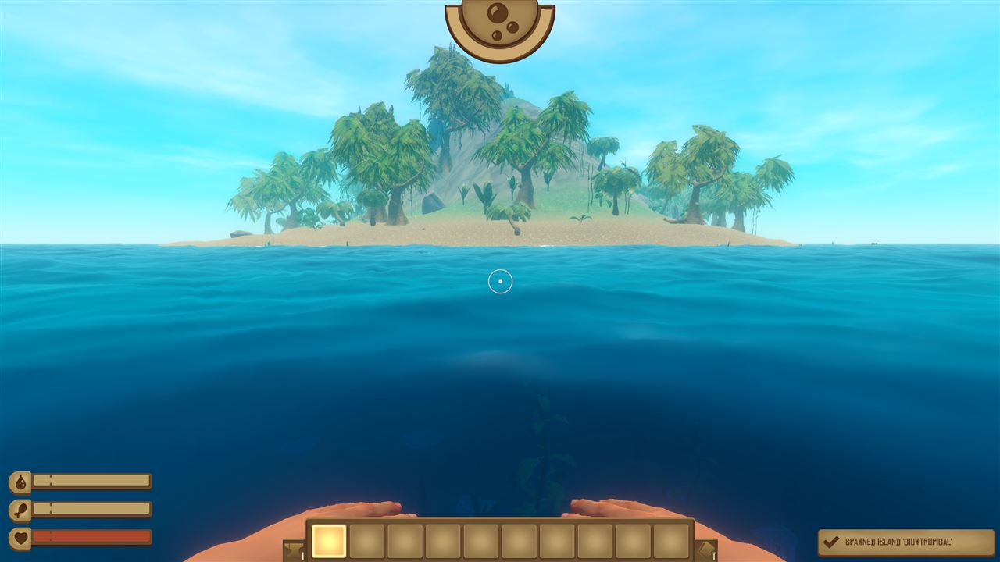

# Custom Islands (DynamicIslands)

A [Raft](https://raft-game.com/) mod for the [Raft Mod Loader](https://www.raftmodding.com/) (RML): build your own islands in an in-game editor, then find them in your worlds while sailing.

Custom Islands version 3 by **SwedenJohansson**: rebuilt for Raft 1.1 (Unity 2021.3) and extended with the editor, generator, quests, world plans, storylines, island library and multiplayer described below. Based on DynamicIslands by FranzFischer78 (code) and MegaMatrixs (design).

> **EXPERIMENTAL ALPHA RELEASE** - this is the first release of Custom Islands (version 3.0), an early alpha. Things are likely to change, some
> systems might be unstable, and we do not guarantee that progress is always saved: back up the worlds you care about.
> The main menu shows this in a box (**Got it** folds it, **X** closes it, both until the next version). Found a problem? See
> [Reporting a problem](#reporting-a-problem).

**What changed:** see the [changelog](CHANGELOG.md) for every version 3.0 update since v1.1.1.

**New here? Start with the [illustrated guide](docs/GUIDE.md)** (also as a [PDF](docs/Custom-Islands-Guide.pdf) to download or print): installing, starting a world, what you meet while
sailing, building your own islands in the editor and giving them quests and stories, world plans that make your own adventure (with a step-by-step first plan), playing together, and at the end
the optional world systems (world rules, randomizer, extra options, the level up system), step by step with pictures. It starts with a quick start table and the words it uses.
This README is the full reference, in the same order: island creation first, the optional systems after.

[](docs/GUIDE.md)

## Features

- **Hazards and gap features** (2026-10-24): trigger zones that hurt (acid, live water, fumes, spikes, cold), darken
  the screen without a headlight or take the breath without an oxygen tank, unless a suit or another check protects;
  checks **wears item** / **holds item** (binoculars, hooks, axes), the actions **protective suit** and **hurt
  creatures**, zapping butler bots, bosses only blasts hurt (explosive barrels, pillars), lights that keep creatures
  back, item sockets, repairable snow vehicles and generators that want 3 parts - all made in the editors.
- **Quest mechanics** (2026-10-24): zones that **push** players (fans, wind, updrafts, knockbacks) and switch on and
  off (**pulse**: steam vents, firebombs); pieces players **carry** (no jumping or ziplines meanwhile; a hit drops them)
  and **stack targets** that count them; **lures** that draw a spot's animals (with a bait item: food lures); the
  shared actions **collapse** (rumble, shake, fall away) and **move to marker** (a cart to a ledge, an antagonist to the
  next arena, carrying players); bosses **guarded while** checks hold - all in the editors, saved, and shared in multiplayer.
- **Island editor** (EDITOR button in the main menu)
  - **Islands and world plans apart:** EDITOR opens a start window, "What do you want to make?", with three cards: **An island** (New island / Open an island... / Continue the last one, with its picture), **A world plan** (New world plan / Open a world plan... / Continue the last plan and its Main story line in a few words) and **The guide**. The card of what you made last is lit. A world plan is made right on the main menu: no island is loaded and no 3D editor opens. In the island editor, **Use in a plan...** puts the island in a plan (next in the Main story line, or another island that comes on its own); on a plan's island card, **Edit island** opens it in the 3D editor, with **Back to the plan** in the top bar.
  - Sculpt the terrain with a round brush, 1 m to 160 m across: Raise, Lower, Flatten and Smooth.
  - Paint it with Raft's own ground textures (Sand, Grass, Rock, Seabed), or let it texture automatically by height and slope.
  - **Island styles:** Tropical, Snowy (Temperance), Desert (Caravan Island), Forest (Balboa) and Volcanic. Each style has its own ground textures, and the paint buttons are named after them.
  - **An editor screen in Raft's own look** (its menu sprites, brown panels, tan buttons and fonts, taken from the game at start): a top bar (file, undo/redo, the Terrain / Objects / Island tabs), a tool panel with related buttons grouped in bordered boxes, an object browser with pictures, and a status bar that explains the tool or the button under the mouse. The camera moves like Unity's scene view (right-drag looks, dragging up looks up; WASD flies; Alt + right-drag zooms); **Camera...** in the status bar lists every mouse button and key of the editor (camera, tabs, undo/save, terrain and object keys) and sets this PC's look sensitivity, move, zoom and pan speed, the drag-up and wheel directions ([The editor](#the-editor)).
  - **Esc closes every window of the mod**, the topmost one first, one per press; a window with unsaved changes (World plans, a quest, a note, story items, behaviour and events) asks first: Save and close, Close without saving or Keep editing.
  - Place **every object of Raft**, about 1,900 in all, from a browser with a picture of each one:
    - palms, snowy pines, birches, cacti, bushes, boulders, snowdrifts, icicles, corals
    - sunken barrels, containers and buoys, and scrap on the ocean floor to dive for; generated islands scatter some around their underwater slopes
    - harvestable palms, pines, birches, mango trees, rocks, berry bushes, pineapples, and copper, iron, clay and sand
    - props from Vasagatan
    - **the abandoned rafts' crate** (Loot & chests): Raft's own box from the small drifting rafts - taken whole, it gives Raft's random loot for those rafts (and now and then a cooking recipe or a mystery package); remembered as taken, back after the regrow days. What's inside can't be chosen (use a chest for chosen loot) and it doesn't count for a quest's "Open a chest" step - the list hint, the selected crate's panel, the quest editor and Check say so
    - **Raft's own building blocks** (88: foundations, floors, walls, doors, windows, pillars, stairs, ladders, fences, roofs), to build huts on islands or **your own abandoned rafts**. Over water they float at the sea surface. An island of only objects (no land) spawns as just those objects, and players can walk on them.
    - **everything else you can build on a raft** (about 230: storage, beds, grills, lights, decorations, plant pots, sails...), as decoration
    - **the objects of every one of Raft's islands and landmarks:** the abandoned rafts, the radio tower, Balboa, Caravan Town, Tangaroa, Varuna Point, Temperance and Utopia. These load from Raft's island scenes the first time their category is opened (about a second each). The mod ships a list of which island each object comes from (`catalog_index.txt`); after a Raft update the main menu makes a new one in the background (under a minute).
  - Move, rotate, scale, duplicate and delete objects. Click an object to select it; Shift+click adds to the selection.
  - **Placing objects:**
    - a search box finds objects in every category, loaded or not
    - Q/E turns the object, [ and ] resize it, and Shift+click keeps placing copies
    - objects from Raft's islands are drawn where they are placed, also Raft's pre-combined (statically batched) scenery: before, a copy of one drew where it stands in Raft's own scene - the library's Stranded Gull had an invisible boat, its locker floating over the sand
    - objects from Raft's islands stand straight when placed: a small lean they had in Raft's scene (a ladder against a wall) is taken off; a lean over 25 degrees (a boulder on its side) is their look and stays
    - on a slope an object goes down to the lowest ground under its base (a house on legs stands on all of its legs, a van on all of its wheels)
    - **Random** gives each placed object a random turn and size
    - **Slope** leans objects with the ground
    - **Ground** puts the selected objects down on the terrain by their base (the lowest ground under them)
    - objects standing on the ground go up and down with it while you sculpt (one undo step with the stroke)
    - **Grid** snaps placing and moving to a grid, and Q/E then turn in 90° steps; **Grid size** 0.5 / 1 / 1.5 / 2 m (1.5 m is Raft's building grid), kept on this PC
    - clicking picks the smallest object under the mouse by its real shape (a flower beside a big palm), clicking the same spot again gives the next object there, and a light blue outline shows what a click would select
  - **Creatures:** place Raft's own animals on your island (23 kinds), from the object browser:
    - **Animals: catchable:** chicken, goat and llama. Players catch them with Raft's net launcher and keep them on the raft, as on Raft's own islands.
    - **Animals: hostile:** warthog, pig, bear, mama bear, polar bear, hyena, rats, roach, bee swarm, screecher and Caravan Town's white screecher.
    - **Animals: harmless:** Temperance's puffins and Utopia's butler bot; they walk or fly about and never attack.
    - **Sea creatures:** puffer fish, angler fish, turtle, stingray, dolphin and whale. A turtle, stingray, dolphin or whale that a quest asks for stays at the island until it is beaten.
    - The editor shows each one as a coloured marker with its name, or as Raft's real model once you've been in a world since starting Raft.
  - **Creature editor** (select a creature): how many live at that spot (1–8, a herd), difficulty presets (Easy / Normal / Hard / Boss), **health, damage, speed and size**, and whether killed or caught animals come back. **Boss phase** (hostile animals): once per fight, at a share of its health (default 50 %), the spot calls up to 6 more creatures (its own kind or another hostile one), gets faster (×1.3 by default), sends a signal (`phase` by default) and runs its `phase` event; the fight is saved, so a reload mid-fight comes back in the second phase without calling again, and the spot's defeat clears it for the next fight. The host runs it; every player's hits count (`BossPhases.cs`).
  - **Colour:** tint any object, creatures included, with swatches, a strength slider, or your own red/green/blue mix.
  - **Notes:** "Notes & signs" has a paper, a bundle of papers, an open book, a sign, a notice board and a message in a bottle, and **any object can be made readable**. The **note editor** has a title, the text (several lines) and a preview of how players will see it.
  - **Loot (chest editor):** "Loot & chests" has chests, a sealed crate, a wooden box, barrels, a sunken barrel and a wild beehive (honeycomb - Raft has no wild hives), and Raft's story pieces work with the player's own quest tools: Balboa's choppable vines are cut with the machete (kept for later vines), Raft's zipline lines are ridden with the zipline tool (their far end can be put anywhere: Far end in the object panel, `zip.to`), Raft's **quest item pickups** (23: keys, keycards, tokens, parts) give the crew Raft's quest items as story items, Raft's **keycard doors** and key doors open only for the story item set in the inspector (Keycard door > Card; **Card used up** takes it; Check warns about a key door no story item opens), **buried treasure** is found only with the metal detector (it beeps faster nearer) and dug with the shovel, once for the whole crew, with optional **Extra loot** (story items too), Raft's own **wild beehive** gives honeycomb, any usable object can have a **keypad code** (typed before it works), and **buried treasure** is Raft's own treasure point for the metal detector and the shovel (dug-up treasure is remembered, and buried again after the regrow days), and any object can hold loot. Choose the items from all of Raft's items with pictures and a search, set the amounts, or pick a ready-made set (Basics, Metal, Food, Treasure). A chest fills up again after the regrow time, or never.
  - **Trigger zones:** an invisible area (a sphere in the editor). When a player walks in, it shows your message, gives items, and wakes up the creatures that wait for it (an **ambush**). It fires once per world (again after the regrow time) or every time. A zone can be an **air pocket** (its **Air** row): a player inside breathes - breath full again - as in Raft's air pockets under Caravan Town, whose objects come without their air; hidden by a behaviour, it gives no air until it is shown.
  - **Island info:** give the island a name, an author and a short description (Island tab). Players see them as a banner when they arrive (only islands with a quest show it).
  - **Signs:** a readable sign shows its note's title on its board, in the editor and in a world.
  - **Atmosphere zones:** fog colour and thickness, a light tint and particles (fireflies, mist, snow, embers, bubbles) around a spot. A dark tint really darkens a cave or a buried room: Raft's sun, the sky's light and its reflections take it too while the camera is inside. Fly the camera in to see it. It fades in at the edge and never changes Raft's own weather.
  - **Sound zones:** one of Raft's own 500+ sounds (ambience, birds, wind, music...), chosen from a searchable list where you can listen first. It plays while a player is inside, louder towards the middle, or once when they walk in.
  - **Quests** (Island tab, **Edit quest...**): a title, an introduction, up to 10 steps in order (**go to** a trigger zone, **read** a note, **open** a chest, **defeat** or **catch** a number of animals, **collect** a number of a story item, **find** a number of journal pages on the island or anywhere, find one of Raft's **blueprints** - carried or learned, while at the island), a reward and a closing message. Steps point at things on the island by name, and the editor lists the names it knows.
  - **Object groups:** select objects and click **Save as group...**. The group appears under "My groups" at the top of the object list, to place on any island as one piece. Once put down, it becomes its separate objects again, with their settings. Groups are files in `Mods\DynamicIslands\groups`.
  - **Terrain stamps** (Terrain tab): click to put down a Hill, Peak, Crater, Mesa, Lagoon or Ridge, as big as the brush; Q/E turn it. **Save stamp...** keeps the land under the brush as a stamp of your own (`Mods\DynamicIslands\stamps`).
  - **Behaviour & events** (select any object, "Behaviour & events..."), no code needed:
    - **a name** that actions refer to (objects with the same name act together)
    - **movement:** spin (around the vertical, or around its own up axis: a tilted water wheel, a fan), bob up and down, or move and turn between two poses, either **back and forth** for ever or as a door, gate, bridge or lift that **opens and closes** (with a Preview in the editor)
    - **hidden at first** until an action shows it (a hidden creature spot is an ambush); hiding a creature spot again takes its animals away until it is shown
    - **players can use it:** Raft's "press E" hint with your own text ("Pull the lever")
    - **collision:** Raft's own, walk through, one box, or solid
    - **when … then:** a player uses it, walks into a zone, reads a note (first time), opens a chest, or all the animals of a creature spot are defeated, a boss spot's second phase begins, or a laser beam reaches it → **show / hide / show-or-hide** objects, **open / close / open-or-close** doors, **say** a message, **give** items, **play** one of Raft's sounds, **play sound/music** for everyone near (Raft's sound events and music cues from a list, a volume, once or on a loop, near the object or island-wide; it stops when a player leaves the island and a loop comes back after a reload) and **stop sound**, a **camera moment** (the view from a marker toward an object for some seconds, the player held, Esc skips; for players within range), **teleport** the player to an object (an action that works on objects names them; the name field empty, or **(itself)**, means the object the actions belong to), **send a signal** (world plans and island rules can wait for it), write a **journal page**, **unlock one of Raft's characters** for the player, or **wait** a number of seconds before the actions after it (a gate that falls shut again)
    - **only if …:** checks before the actions run: the player **has** an item or a story item, or **uses one up** (a key), an object **is** open / closed / shown / hidden, a **signal** was sent, the quest reached a step. Each check can be turned round (**not**: "the crew hasn't got the key yet"), and the checks can be **all of these** or **any of these**. **Otherwise** a message ("It's locked. Maybe there's a key somewhere..."); an island file written by hand can give Otherwise any action, and the editor keeps them (it shows only the message)
    - **Island events** (Island tab): when players first come to the island, and when its quest is done
    - **Locked chests:** a chest's "Only if..." decides whether it opens: without the key it says so and keeps its loot.
    - A door that is used without actions of its own opens and closes itself.
  - **Story items** (Island tab, **Story items...**): keys, map pieces, logs... with a name, a description and a picture (Raft's quest item pictures or any Raft item). Chests, zones, quest rewards and "give" actions hand them out (the item picker lists them first), and "only if" checks ask for them. **Raft item...** beside an item links it to one of Raft's own items (**-** clears it), so players can take it out of the journal as that item; it stays a journal item in the save.
  - **Story sets** (in the Story items window): ready pieces of a story placed around the view in one undo step: **a locked door and its key** (in a chest with a note), **a trail of notes** that leads to a hidden chest with a story item, **a treasure map** (a message in a bottle gives the map; walking to the X with it digs up a buried chest), or **a locked chest** with driftwood nearby that hides its key.
  - **Invisible walls and ramps** ("Zones & triggers"): solid in a world but not seen. Block a path, keep players in an arena, or make a cliff or sea stack climbable. Scale and turn them to fit.
  - **Island rules** (Island tab): how many in-game days until chopped trees, picked items, killed or caught animals, looted chests and fired zones come back on this island (empty = the world's setting, 0 = never).
  - Undo and redo everything, and save or load islands.
  - **Autosave:** unsaved changes are kept every 3 minutes, and when leaving the editor or quitting Raft (`autosave\<name>.island`); after a crash the editor offers them back when it opens (or throw away one island's work with the X on its row). Saving over an island that saved worlds have says once which worlds get the new version.
  - **Test in a world:** the top bar's **Test** tries the island at once in the world "Custom Islands test" (made the first time, nothing else in it), beside the raft with you standing on it, with a **starter kit** (metal spear, machete, bow and 20 metal arrows, metal axe, hammer, scrap hook, metal fishing rod, shovel, head light, flippers, oxygen bottle, 10 cooked meat, 3 canteens of fresh water; hunger, thirst, health and oxygen full); **Esc → Custom Islands → Back to the editor** comes back to it without saving the test world. There, **Kit: On/Off** switches the kit for the next Test (`testkit.txt`) and **Give the kit** gives it again.
  - **Light:** the top bar's **Light** shows the island at Morning, Noon, Evening, Night or Overcast (sun, shadows, sky light, haze) - only in the editor.
  - **Generate** an island to start from (see "The island generator" below): three tabs. **Normal**: seed, style, **layout** (**Raft small island** - the first one: the outline and ground of one of Raft's own small islands picked by the seed, turned, mirrored and wobbled, with a beach all round to wade onto from the raft -, Raft large island, round, atoll, archipelago, sea stacks, plateau, marsh, crescent, twin peaks), size and highest point with **Small island / Large island / Balboa** buttons measured from Raft's own islands, peaks and their shape, hills, coast, bays, beach, cliffs, stretch, valleys, lakes, terraces, erosion, **under water like Raft's own islands** (a deep sea floor 160 m down with a shelf and a drop-off, and corals, sea vines, rocks, stones, clay, scrap, ores, giant clams and sunken barrels placed from measurements of Raft's islands), a slider for each kind of object (trees, bushes, rocks, beach things, harvestables), **Things to gather** (trees to cut, fruit, berries, flowers, Raft's dirt spots and wild beehives, as suit the style) and **Finds in the shallows** (sand, clay, stone, ores, scrap, clams and seaweed just off the shore), each from none to much, up to a jungle you can barely walk through, **animals** (hostile, friendly, sea; which kinds, how tough) and **loot boxes** with tiers 1-5; your own saved presets. **Randomize existing**: pick one of Raft's 33 islands from its picture, then "something new like it" or "a variation of it" (its own ground, reshaped). **Ready-made**: the map types as cards. Everything the generator places stands with all of its base on the ground (on a slope down to the lowest ground under it, measured on the terrain's own triangles; snow drifts lie along gentle slopes, never steep ones). A live preview map shows the island as you move the sliders, and a line above the seed says **whether players can get onto it from their raft** (easy, by jumping onto a ledge, only by building); every setting has a "?" to hover for help. The same seed and settings always give the same island.
  - **Map types** (Generate window, **Ready-made** tab): whole islands with content, made from a seed and opened to edit: sandbar, atoll, archipelago, sea stacks, boss island, volcano, swamp, frozen spire, treasure island, old camp, sunken island, sky island and wreck (see "Map types" below).
  - **When the quest is done, bring a new island** (quest editor): a saved island or a new island of a map type, how far and which way from this island, a message for every player and a name on the Receiver. **Islands it brings...** (Island tab) edits all the island's rules: also "when step 2 is done", "when zone X fires", "when players first get here".
  - **World plans** (EDITOR → A world plan, or the island editor's **Use in a plan...**): plans for new worlds, made of rules (see "World plans" below). A plan window with three tabs (**Main story line**, **Other islands**, **Settings**) and rule cards, **Check** (finds rules that can't work, and any of Raft's story blueprints a plan never gives - with which island gives which, in play order; a main quest needing a tool no island before gives; one story item id given on two islands; a story item an island uses but no longer has in its Story items list), **Progression** (a panel in play order: Raft's story islands kept and which rule's islands give which of Raft's blueprints, tools and story items, locks and tool-locked features before their item, where a lock's kept story item came from, blueprints given before the ones they build on, blueprints never given) and a sketch of where islands go, plus ready-made templates.
  - **Your islands in Raft's story** (World plan window): Raft's story islands on or off, each one left out or replaced, and a plan's islands put into the Receiver chain (first, after an island, in place of one) with their own frequency on Raft's Receiver that any player can dial, or coming by chance while sailing; each is "done" when its quest is (or a step, a zone, a signal, a note read, players reaching it), which unlocks the next (see "Raft's story and the Receiver" below). Islands in the story are the **main story** (Raft's notebook); every other island is a **side quest** (the journal).
- **In your worlds**
  - Islands appear on their own ahead of the raft while you sail: one after every **3-6 of Raft's own islands** you meet (the world's span, chosen in World settings: from 2-4 up to 20-50; `WorldIslandsGap` in a world), none in a new world's first 10 minutes of play (`quietMinutes`), so however many islands take part they never crowd the sea. They're kept away from Raft's own islands, and far-away islands are unloaded to save memory.
  - **A finished island never comes again by chance** (its quest done, or reached when it has no quest); one you haven't finished (or with a note not found yet) that the pool picks again comes back ahead of the raft as you left it, not as a second fresh copy. One the world already has counts a quarter of its weight, so new islands come first; a builder can set the earliest an island may come by chance ("Comes by chance after 40 km sailed", shown as about 5 h of sailing).
  - **Islands you still need come back**: Raft's current carries the raft one way, so an island the players still need - its quest begun and not finished (up to three times), or one a world plan waits for (it leads to the next island; every time), or one a day / km rule with **again until done** brought (every N days / km, even never reached, until finished) - turns up ahead of the raft again about 12 minutes after the raft left it behind, as it was left (quest, chests, harvest), with a banner; for every player. Not islands found with a Receiver frequency (the Receiver shows the way). `returnMinutes` in `spawnpool.txt` (0 = never).
  - Now and then a **brand-new random island** is generated instead: random size, style, and sometimes flying. It's saved as `gen-<style>-<seed>.island`, so it stays in that world. In World settings > Islands while sailing it is the row **Brand-new generated islands**: untick it and only made or downloaded islands and map types come. Its **?** says how often one comes and how to keep one: EDITOR > An island > **Open an island...** lists them, then **Save as** a name of your own. Set with `generated`, `generatedStyles`, `generatedFlyingChance` and their things to gather (`generatedGather`, `generatedShallows`, `generatedShallowsDepth`, `generatedGatherOff`) in `spawnpool.txt`. Lines like `type:wreck 0.4` mix in **map types** (sandbars, wrecks, atolls, sunken islands... see below).
  - **Custom islands show on Raft's Receiver** as green dots with their distance, so you can navigate to them - those within `receiverDistance` (2000 m), and every island you still need however far. Turn this off with `showOnReceiver = 0`.
  - You can also spawn one yourself with `SpawnIsland`.
  - **Missing islands are named when a world loads:** when a world uses island files this PC doesn't have, the host (or single player) gets an **Islands missing** box naming them - and the library entry each came with. **Play without them** leaves them out (no Receiver dot; kept in the world, so they come back once the file is here, or a joining player brings it); **Main menu** leaves without saving, to download or restore them first. Joining players get missing files from the host as before.
  - Islands are saved with the world. You can walk on them, the raft runs aground on them, and palms, mango trees, rocks and berry bushes can be harvested.
  - **Flying and underwater islands:** give an island a height in the Islands window, or with `SetElevation`, or when spawning. A flying island loses its seabed and gets a rocky underside, and the raft sails underneath it. An underwater island sits below the surface for divers.
  - Chopped trees and picked-up items stay that way, even after the island unloads or the world is reloaded. They grow back after 3 in-game days (set with `regrowDays` in `spawnpool.txt`; with several players, the host's number, and the host decides when: they come back when the island loads on the host after that many days).
  - **Creatures come alive:** the host spawns Raft's real animals at the island's creature spots with the builder's stats and colour. They roam around their spot, and Raft's own networking brings them to the other players. Angler fish swim rounds: Raft's follow a route their island has for them, and a built island's get a ring of waypoints around their spot in open water (without it they hung still and Raft's swimming state threw an error every frame). Killed and caught animals are remembered like harvested trees, and come back after `regrowDays` unless the builder turned that off. Caught animals become normal raft animals.
  - **Notes:** look at a readable object and press the interact key (E) to read it. Close it with E, Tab, Esc or the button. (Esc in any of the mod's windows in a world - journal, note, code lock, stats page - closes only that window, not also opening Raft's pause menu.)
  - **Raft stores:** **TradingPost** (Islands list) is Raft's trading post, working: Raft's store window, goods and prices (trash cubes, trade coins), trophy fish sold there, Raft's own reputation tiers. Each store also sells the Raft story blueprints the player hasn't found (6 trash cubes, one each), so a missed blueprint for a quest's **blueprint** step can be had later. Stock is per store, saved with the world and the same for every player; a joined player's purchase goes through the host. Recipe verb `store` (`RaftStore.cs`, `BlueprintSteps.cs`).
  - **Raft's vending machine:** **VendingMachine** (Islands list) is Tangaroa's vending machine, working: Raft's six buttons, goods and prices (two of a Tangaroa plant for one Tangaroa token), the package in the hatch. A waiting package is saved with the world and the same for every player; a joined player's press goes through the host. Tokens come from Raft's `QuestItemPickup_Tangaroa_Token` pickups. Every library storyline has one on a story island; Gullsong Bazaar has one too. Recipe verb `vending` (`RaftVending.cs`).
  - **Survivors to rescue:** **Survivor in a cage** (Loot & chests; Raft's shark cage with one of Raft's characters inside) is locked with a story item. Whoever's crew holds the key presses E: the key is used up, the cage opens for everyone, the survivor says the builder's line in a speech bubble and then stands on the raft as decoration. The world keeps its survivors (one per survivor id, saved with the world, sent to every player) and the cage sends a signal (`survivor` by default) for quests and world plans (`Survivors.cs`).
  - **Chests:** look at one and press E: the items go into your inventory (what doesn't fit drops in front of you), and the chest is empty for everyone, also after reloading, until it fills up again. A chest with a note shows the note too.
  - **Trigger zones** fire for whoever walks in; an ambush creature appears the moment its zone fires.
  - **Quests:** an island can have several (a main quest and up to eight more, each with its own steps and reward). Within about 70 m of an island with a quest, a panel shows its steps (it stays up out to 150 m) (done ones ticked); once all its quests are done it goes after 30 s, and its × closes it until the next step. The introduction shows when you arrive, and each step done shows what's next. The quest is shared by everyone in the world and saved with it. When it's done, every player near the island gets the reward's items (its story items go to the crew's journal once); a player who was elsewhere or joins later gets their share on coming to the island, once, and sees "Your reward for '<quest>' waits for you at the island - sail there to get it".
  - **Arriving** near an island that has a quest and a name or description shows it as a banner at the top of the screen, once per island per session. Banners and messages come one after another: one that arrives while another is on screen waits until that one has gone. Each stays long enough to read: 5 seconds for a short one, longer for a long description (up to 16).
  - **Key tabs at the hotbar:** beside Raft's own (inventory, notebook) the journal's (J) and, while the level up system is on, the stats page's (K) - copies of Raft's tab, so they look and hide as Raft's do.
  - **The journal** (J): the crew's book of the custom islands - their story items with pictures and counts (one its builder linked to a Raft item has **Take out: <item>**, which turns one into that item in your inventory; the host decides who gets the last), and every custom note read (once, the first time anyone reads it), pages written by island events and the frequencies a plan gives out, read on paper. Pages are listed by island, each island under its name, its quest's title (√ done once it is, the line in light green) and its notes found of its notes with a text ("(5/7 notes)": some are still left on it), so notes from several islands don't mix. The head shows the world's custom quests done (**QUESTS 7 / 20 · 35%**, with a bar; click it for the list; Raft's own story isn't counted): the plan's islands in the story (as the chain counts them), the plan's other rules' saved islands with a quest (counted from the start, before they come) every other island with a quest that has come, and (random islands on) the islands ticked for the world that have a quest and haven't come yet (`QuestCount` in `StoryItems.cs`; refreshed every 2 s while open). A **Progress** panel over the page shows the world's progress, each as found / total (hover a line for what it counts): Quests (and %), Islands reached, Notes found, Story items found (used-up ones too: `StoryBook.FoundIds`), Journal pages (the islands' notes and their events' journal pages, `IslandCache.EventPagesOf`) and Overall (%) - over the custom islands in the world and the saved islands its plan brings (`WorldProgress`, `NoteCount`). At 90% every player gets a banner "Nearing the end", at 100% "The whole quest line is done" (and the count says ALL DONE): each once per world (`milestone:90` / `milestone:100` in the world's `@done=` line), not in worlds with fewer than 5 quests (`QuestMilestones`, host; `CIQuestMilestones` tests it). One journal for everyone in the world: the host keeps it, joining players get it, saved with the world. Quest steps "Find a story item" and "Find pages" count what it holds; the quest itself shows in the quest panel at its island. The journal is for the **side quests**: a world plan's **main story** is in Raft's own notebook (next item). A story item linked to one of Raft's own items has **Take out**: one leaves the journal as that item, into your inventory (the host decides). With the world option **Daily quest** on, a **Daily quest** block under the page shows today's task and how far along (with a bar), the reward, whether it's done (and whether you got the reward) and when the next one comes (at daybreak).
  - **The main story in Raft's notebook (T)** (`QuestBook.cs`): every island a world plan puts in its main story (STORY: first, after an island, in place of one, or beside Raft's story; always found by its coordinates on the Receiver - Check calls one that isn't a problem) gets a **tab** in Raft's own notebook - copies of Raft's own tabs, pages and papers, so it looks like Raft's - in story order between Raft's tabs (alone when Raft's story is off; left-out and replaced islands' tabs hidden, their pages at the back). The tab shows the island's name (or a **tab title**), one of Raft's nine tab colours and its Receiver **#frequency**; its pages: the **intro** the plan gives it, its quest's **checklist** (steps done crossed out, the one to do now; more pages for a long quest) and the **notes read** on it; its story items in Raft's **Found items**; after the last main story island the plan's **ending page**, with a banner. The tabs scroll when there are more than fit. Every player builds the same book from the world's story chain (the main story rules travel with it), so page numbers and Raft's page flips match. Nothing goes into Raft's own notebook save (our notes are never in Raft's list of notes found): a world opened without the mod has Raft's book. The journal then leaves the main story out and says how far it is (a main story island's further quests and a generated main story island's quest included). A story line puts every island it depends on in the main story (brought by a main story island, or holding a story item one needs); `content/questbook_check.py` checks every plan for it. When the main story ends, every player sees the plan's **credits** once (`StoryCredits.cs`): its title, the makers' names and the closing note; a reloaded world doesn't show them again, and Raft's Utopia ending is untouched.
  - **Making a main story** (World plan window, Main story line tab): **New main story line** (a helper: Raft's story on/off, your islands in order, colours, what gives the next coordinates - it makes the rule cards), the rule card's **NOTEBOOK** row (tab title, colour, first-page intro) and **THE END** card, "next coordinates when" also **a note is read**, and **Preview notebook**: the plan as it is in the window (saved or not) in Raft's real notebook in the test world, every page, with a bar that steps through the story the way players meet it (start, back, next, all) and back to World Plans. **Check** warns about main story islands without notes, notes too long for their paper, story items without a picture.
  - **The world's settings in a running world:** **Esc → Custom Islands** in Raft's pause menu opens them (world rules, randomizer, extra options, level up system, islands while sailing, the plan and story); the host changes them for every player, others see them. A compact window (tick boxes, short scrolling lists) that fits a 1366 x 768 screen; each group says what a change does in a world already under way.
  - **Ready puzzle pieces:** Raft's turning mirrors, water wheels and pipes turn a quarter each use, wire connectors take Raft's electrical cable once, the claw crane console and the justice scales send a signal - each sends its own signal, and checks on their states make a puzzle (guide 15.8). Laser beams: an emitter's beam goes by the mirrors, and what it reaches gets the event "laser" (a door panel sends `laser`).
  - **Boss arenas:** the boss island's arena shuts the crew in with stakes until the beast is defeated (two minutes at most, and it shuts again when someone steps back in while the beast lives); then the spoils show.
  - **Behaviours:** doors, gates and lifts move for every player; things that move back and forth, spin or bob follow a clock all players share (Raft's water time), so everyone sees them in the same place; what is shown, hidden, open or closed is shared by all players, saved with the world and sent to players who join. Messages, items, sounds and teleports go to the player who did it (for defeated animals and finished quests: to everyone near the island).
  - **World plans** decide which islands a world gets (see below): chosen in Raft's **New Game** box ("Custom Islands plan" → **Choose plan...**: a window with every plan, its picture, description and islands), or in a running world by the host: Esc > CUSTOM ISLANDS > Plan (or `WorldPlan <name>`). "Random islands" (the default) is the old behaviour.
  - **Rafts of blocks you can walk on:** Raft's building blocks on custom islands (wrecks, ghost rafts, a raft built in the editor) float like the player's raft, with the deck a player walks on (see [World settings](#world-settings-more-ways-to-play-raft-again)).
  - **New islands from rules:** when a rule brings an island (a quest done, a zone, a visit, km sailed...), every player sees a banner with the message and how far and which way it is, and the island's green dot on the Receiver carries its name.
- **Multiplayer (up to eight players, Raft's maximum):** the host's islands are sent to players who join, together with any island files they don't have and what has been harvested there. Harvesting and picking up items stay in sync. Only the host checks world plan and island rules; quests and zones done by other players count, because they reach the host. The World settings (world rules, randomizer, extra options, islands while sailing) are the host's for every player, also those who join later. The host takes a player's reports (used, harvested, quest progress, fired rules) only from near that island, switches levels on itself, and puts back a level record with more EXP than it credited.
  - **Another player can host the world next time.** Every player who was there for the last save already has the world (see *The world travels with the players* below) and just loads it. Otherwise: Raft keeps a world on the host's PC; copy its folder (`...\LocalLow\Redbeet Interactive\Raft\User\User_<Steam id>\World\<world name>`) to the next host's PC. The mod's state of the world goes along: the host writes it into that folder too (`CustomIslands.txt`), and every player keeps a copy of it (`worlds\<world id>.txt`, sent by the host each time Raft saves). When the world loads, the newest copy is read. Islands a player only has from joining are played from their downloaded copies (`<name>_<hash>.island`) under their own names, so quests, rules and journal pages that name them keep working. Everyone keeps their level, EXP and points, and the world keeps its World settings.
  - **Share islands and plans as packs.** **Export...** (the editor's Islands window, the World plan window) writes a `.zip` with the island or plan, every island its rules bring, a picture of the editor's view and an info file (title, author, summary, description, tags, players, length, whether others may remix it); exporting again makes the next version of the same entry. **Import...** installs a pack from `Mods\DynamicIslands\import`: it never overwrites your own files (a clashing island is installed as `Name (Pack title)` and the pack's rules follow), refuses broken or harmful packs with the reason, warns about packs from a newer mod version, updates what an earlier version installed (worlds already started get it when its objects keep their order, else keep the version they started with - the same rule as editor saves), and lists what's installed with **Remove** (keeping what a saved world uses) and **Tidy up** (island copies from hosts no saved world uses, generated islands nothing uses - to the deleted folder - and the files of worlds deleted in Raft that this PC hosted - to `worlds\removed`). A pack never sets World settings: the player's own choices always apply. The layout is the same as a folder of the [island library](https://github.com/SwedenJohansson/CustomIslands-Library).
  - **The island library.** **ISLAND LIBRARY** in the main menu (also **Get more plans...** in the New Game box and **Library...** in the editor's Islands window) lists the world plans and islands of the public island library (a shared Google Drive folder, read without signing in; `library.txt` can point at another folder or a web address), with icons, pictures, descriptions, authors and a search; an island's page says whether it has a quest on it (from its `quest` tag), and an island's row says **Difficulty: Easy / Medium / Hard / Extreme / Impossible** from its monsters (none, 1-5, 6-20, 21-49, 50+: each spawn point's creature count, a range its highest, plus a boss's called animals; animals to catch, harmless animals and sea life and creatures made harmless don't count; only a label, the same in CHOOSE ISLANDS...; the list reads it from the index's `monsters`). It starts with the mod's own **example islands and plans** - 98 quest islands (among them the themed islands: a pirate cove, a beach club, an atomic test atoll, a villa's safe room, a lighthouse, a snowbound lodge, a volcano lair, an island prison, a whalers' village, a lake camp, a jungle pyramid, a flooded cave labyrinth, a sunken liner, a wartime airfield, a contest arena, a marsh of research stations, a park of giant beasts, a frontier town in the canyons, a concrete mining island, a gold-rush creek, a stage-set town, a drowned city, a whaling station, an island of ash that turns green, a sea monster's wake... - and the new islands, each with its own kind of quest: a timed escape from a sulphur vent, a kelp survey, a hermit's riddle, a barter chain in a floating bazaar, a goat round-up, a mail dive under a broken viaduct, a vintner's casks, a circus menagerie loose on an atoll, a beekeeper's mead, an inventor's pumps in order, a bell and a torn chant, a lighthouse of bottles, a maze of red stacks against the clock, a casino heist across seven keys, a village buried in ash, an organ of ice in a sea cave, a bust salt works, twelve festival lanterns, a mapmaker's four bearings, a tortoise island's four trials, a cable car up four sea stacks, a floating town of wrecks voting, a botanist's glasshouses on a cliff, a ship frozen into an ice coast, an oil rig that catches fire, a ship to finish and launch, a regatta sailed round eight buoys, two rival forges on a saddle, an atoll stuck in four seasons, an aqueduct's valves opened in order, a mountain hollowed out by the Delvers, a skeleton's ribs played like chimes, seven drawbridges round a lost town, a star fort holding off the beasts, a whole kingdom waiting for its crown, a clockmakers' city on sea stacks, a fallen star in a crater lake... - plus Turtlewatch Atoll, a sanctuary, and Rookery Cliffs, a sea-bird crag to climb, both without a quest, and twenty-four small and medium islands to wander, also without a quest: a sea-bird islet with a jetty, a driftwood cabin, a bear's cave, two horns and a desert mesa pair joined by rope bridges, two sunken islands with a wreck and a castaway's raft, a landing stage into the sea, a wild mango grove, a snowy skerry, a volcanic cay, a woodcutter's isle, a bay with a wreck on its floor, a little flying islet, a castle ruin over a village, a volcanic tribe's dancing ground, a sunken listening station, a harbour with a long pier, two flying peaks joined by a rope bridge, a drowned graveyard, a ring of standing stones on a hill, a yard of leaking barrels on a volcanic isle, a camp behind a palisade of stakes and a meadow flying 60 m over the sea) and three large ones (a craft crashed in a scorched crater, a desert island of pyramids and a volcanic island half sunk); every island has things to gather that suit it, on land and in the shallows, and 5 world plans built with the editors (The Long Voyage, Raft Remade, Raft 2: The Drowned Frontier, The Abyss Expedition, Silver Screen Seas - Raft's story with the themed islands) and five whole storylines (The Rainmakers, The Last Post, Relic of the Seventh Tide, The Lullaby Frequency, The Gravity Sea): download one and open it in the editor to see how it is made (guide chapter 15). Each entry's button says **Download**, **Update** (the library has a newer version, or one of its files changed there; if you changed some of its files since, you choose: **Update, keep a copy** - yours stay as "name (yours)" - **Keep my changes** or **Cancel**; a world with an updated island says so once when it loads) or **Installed** (with **Remove**). Downloads are checked file by file and installed like Import. **Guide** opens the illustrated guide (PDF; chapter 15 is about the library's examples). **Submit yours...** explains how to get an island or plan in: export it, post the pack on the Custom Islands Discord, and it is approved before it goes in (buttons: the Discord, the exports folder, the guide); creators can also send it with **Share...** after an export (a form on GitHub). The mod goes online only while the window is open, and sends nothing but the downloads; `library.txt` can switch it off.
  - **Learn from the islands.** Any island - from the library, a ready-made one or your own - opens in the editor with everything its builder set: select a thing to see its loot, note, zone or behaviour, and the Island tab shows its quests, rules and the islands it brings. The guide's chapter 16 lists every editor feature with an island to look at. Two small featured islands of the library show many features at once: **The Lockkeeper's Isle** (a keypad code lock, three quests on one island, the island rules, an island its quest brings) and **Lantern Spire** (a flying island, a story item that a behaviour turns into a key).
  - **Saving:** the host's world is saved when Raft is closed (also Alt+F4 or the window's X) and about 3 s after each quest step, quest finish and story step (at most once a minute); players who joined rely on the host's save. A crash or power cut still loses what came after the last save.
  - **The world travels with the players:** after each save the host sends Raft's newest save of the world to every player (and to each player who joins); it lands in their own Raft `World` folder, so whoever hosts next picks it in Load Game - no copying folders. A player's own world of the same name is never touched (the host's goes beside it). Only the last 3 saves a player received of a world are kept (a save over 64 MB packed isn't sent: the host sees a note on screen). Two marker files in Raft's world folders make it work: `CustomIslands-world.txt` (the world's id: written by the host on each save, and by a player into a folder they received) and `CustomIslands-received.txt` (in each save folder received from the host: only those are ever removed, the oldest first).
  - **A newer copy is kept aside.** A player who joins with a newer copy of the world than the host's (by the world's save counter) is told "Your copy of this world (...) is newer than the host's: the host's is played, yours is kept as ..."; the copy is set aside as `worlds\<world id>.kept-<n>.txt` (n = its save count) in `Mods\DynamicIslands`, and the host is told the player's copy is newer. The world goes on from the host's.
  - **Notices a joined player may see:** "The host hasn't sent its custom islands yet (does the host have Custom Islands?). Still asking..." - the mod asks the host for its island list every 5 seconds; after 12 tries (about a minute) this notice comes once, and it asks every 30 seconds from then on until the list arrives. "Waiting for the island '<name>' from the host - still asking" - an island file hasn't come in 30 seconds; it is asked for again every 30 seconds (the notice comes once per island; `Resync` asks at once). "The host has Custom Islands 3.x - you have 3.y" - the versions differ (another build of the same version too, by a stamp made from the mod's files); both should install the same, newest release. "An island from the host is left out: its name can't be a file name here (see the log, F10)" - a name with a folder in it (`\ / :` or `..`), a character Windows refuses, over 73 characters, a space or a dot at the end or a space at the start, or a Windows device name such as `CON`; that island is left out and the rest of the world plays (the editor never saves such a name). "The host didn't answer - try again" - the host gave no answer when you opened a chest or set off a zone; it can come for a player who joined again within seconds of a crash: if it keeps coming, leave the world, wait half a minute and join again.
  - **A world keeps its own copy of its plan.** Its rules are saved with the world when it starts. When the player who made the world edits their plan, the world plays the changed plan the next time it loads (and says so); updating or deleting the plan file, another player hosting with a different plan of that name, or a new plan made under the old one's name never changes it, and the plan goes along when another player hosts the world later.
  - **Older saves go back together.** Raft keeps the last 8 saves of a world; loading an older one in its Load Game box also brings back the mod's state of that save (islands, used objects, quests, journal, settings), written into each save's folder. A host missing an island the plan needs is told which one and where it came from.
  - **One player gets a chest:** when several players open one chest (or walk into a zone that fires once) at the same moment, the host gives it to the first to ask; the others are told someone else got there first.
  - **Once is once for the crew:** a note read or an island reached runs its shared actions once, however many players do it together; a finished quest's checks are made once, by the host; story items from a quest's reward or a "give" action go to the crew once (Raft's items still go to every player near).
  - **A crew that splits up:** the host keeps an island loaded while any player is at it, so its animals, ambushes and doors keep working for players there while the host and the raft are far away.
  - **Everything the host decides is the same for every player, however they came in** (live, joining later, leaving and joining again, restarts), and never taken from a player's own files: the host's `spawnpool.txt` settings that change what players see (`regrowDays`, `showOnReceiver`, `unloadDistance`) go to every player with the world rules; **what grows back is the host's decision** (a player who has the island loaded sees it the next time it loads there); tough built creatures and the randomizer's alphas have the host's health on every player's screen, also for a player who joins mid-fight; only the host can change the host's settings (`Monsters`, `BuildCost`, `Randomizer`, `WorldPlan`, `CustomIslandsAuto`, `SpawnIsland`, `RemoveIsland` are refused for other players); a player's own last New Game choices only apply to worlds they make themselves.
- **Optional world systems**, separate from island building and off in a plain world (see the sections from [World settings](#world-settings-more-ways-to-play-raft-again) on):
  - **World settings window** (New Game box, **WORLD SETTINGS...**): Raft's New Game box stays as Raft made it; one window holds everything below that is chosen per world, with **Raft's own** to put it all back. **Defaults...** sets this PC's `spawnpool.txt` values in a window (random islands, spacing, distances, the Receiver, regrow days, generated islands) and the journal and stats keys; **Mod's own** puts them back.
  - **Monster difficulty:** **Timid, Normal, Fierce, Savage or Nightmare**. Sharks and every other animal that fights players get ×0.75 to ×2 health and damage (see [World rules](#world-rules-monster-difficulty-and-build-cost)).
  - **Build cost:** everything in the build menu costs 0-100% more materials, rounded to the nearest (never below Raft's own).
  - **Rare animal looks:** Normal (Raft's own odds), More (about 1 in 3) or Lots (about half) of the cluckers, goats and llamas come with a rare look, from six per animal: Raft's three and three new ones painted from Raft's textures (jade, speckled and golden cluckers; toggenburg, boer and golden goats; piebald, cream and golden llamas). The journal counts the looks you have tamed (x/6 per animal).
  - **World randomizer:** a normal Raft world that is different every time - animal and shark colours, rare alphas and a Big Bruce with trophy spoils, more animals, moved and extra loot, treasure hunts and camps on Raft's islands, oddity islands, large islands and boss lairs while sailing - without touching Raft's story (see [World randomizer](#world-randomizer)).
  - **Extra options** (each explained in [World settings](#world-settings-more-ways-to-play-raft-again)): ghost rafts (abandoned rafts while sailing, large ones guarded by rats and screechers), private storages (a storage opens only for its builder - and for the host when the builder isn't in the game), long voyage (random islands half as often), iron raft (half damage from shark bites), shared EXP, dangerous nights, a daily quest, a rogue shark, silver and golden barrels, storm days, bioluminescent sea (on some nights the sea and the fish glow blue, and fish bite faster), storm seas (more storms that rock the raft harder and now and then break an edge floor), trader rafts, a head start raft, extra upgrades (better versions of Raft's things to craft), UFO sightings (now and then a flying saucer crosses the sky, glowing at night), lightning strikes (in a storm a bolt now and then hits the sea near the raft, very rarely its antenna; looks only), a ghost ship (on about one night in four a glowing wreck with a ghost crew and good loot drifts past; it sinks at dawn), fog banks (now and then thick fog rolls in for a few hours: islands show up late) and whale breach (now and then, by day, a whale leaps out of the sea far from the raft; kraken arm (rarely a giant tentacle grabs an edge floor: 10 melee or spear hits make it let go, else it tears that floor and maybe its neighbours away; its other arms slam at players near them for a little damage; from day 8, never near an island).
  - **Islands while sailing:** which of your islands (and which map types and generated islands) turn up by chance in that world, from a list with tick boxes.
  - **Single islands and plan islands:** a single island is made or downloaded to be found by chance while sailing; a plan island (one a saved world plan names, or an island that island's rules bring) comes only in its own plan, never by chance, even when `spawnpool.txt` lists it. `rnd-...`, `gen-...` and `Name_<hash>` files are never in the list; a library plan's islands get weight 0 in `spawnpool.txt`. To make an island single, use it in no plan or save a copy under another name (guide ch. 7).
  - **The level up system** (its switch in the window; a world option, islands don't turn it on): hitting a monster floats the EXP it gave over it (**+5 EXP**). An EXP bar styled like Raft's own sits above its thirst, hunger and health bars. Every level gives 2 stat points to spend on the **stats page** (**K**, the **Stats** button by the bar in the inventory, or a click on the level up box): walk, run and swim speed, jump height, damage, health, hunger, thirst and oxygen. Each point is +1%, and a stat takes at most 15. Other players see your level as a small **Lv 5** under your name (see [The level up system](#the-level-up-system)).
- **PC check:** at start, one box on the main menu names what can break saving on this PC (Raft under `Program Files` or a synced folder like OneDrive, `Mods\DynamicIslands` that can't be written, an unzipped `.rmod`) and any part of the mod that failed to start, each with its fix. It also warns when Franz's original Custom Islands mod is loaded too (keep only this one; this mod has its own Harmony id).
- **Hover tips:** resting the mouse on a button of the mod's main-menu windows (plan picker, World settings, library, Defaults...) shows what it does in a small tip by the mouse; the editor's status bar and the in-world window's hint line say it there.
- **EXPERIMENTAL ALPHA RELEASE box** on Raft's main menu (right of the middle, can be dragged anywhere; the place is remembered; hidden while any other window of the main menu is open - Raft's boxes or the mod's): the mod's version and what an alpha means (things change, some systems may be unstable, progress isn't guaranteed to be saved), with **Discord** (the Custom Islands server), **Guide (PDF)** (the guide, which comes in the `.rmod` and is written to `Mods\DynamicIslands\Custom-Islands-Guide.pdf` to open it; online if it is missing) and **Report a problem** (a box with what a report needs and buttons: copy a report form with the versions, open Raft's log folder, a new GitHub issue with the form, the Discord). **Got it** folds it into a bar with the same buttons (its **Show** opens it again) until the next version of the mod (`notice.txt`); its **X** closes it altogether until the next version, and a small **Custom Islands: help** button in the menu's bottom right corner opens it again (with Discord, Guide and Report a problem).

## Installing

Install RML, then put `DynamicIslands.rmod` in Raft's `mods` folder, or get the mod from raftmodding.com. Every player in a multiplayer game needs the mod. The first start after installing or updating the mod takes about a minute longer: RML compiles it, and the main menu says so once.

Island files and settings live in `<Raft>\Mods\DynamicIslands\`:

| File | What it is |
|---|---|
| `*.island` | Saved islands (and the ones installed from packs). Share them with **Export...** (a pack with the islands they bring). |
| `exports\` | Packs you exported, and `exports.json` (what you filled in, so the next export is the next version of the same entry) |
| `import\` | Packs to install (**Import...**) |
| `library\installed.json` | What each installed pack wrote, so it can be updated and removed |
| `library.txt` | The island library window: `online = on/off` and the library's `address` (default: the shared Google Drive folder; a GitHub or other web address, or a local folder, also work), and an optional `key =` (a Google API key: the Drive folder is then read through the Drive API instead of its public listing) |
| `library\cache\` | Pictures from the island library, kept so they needn't be downloaded again (safe to delete) |
| `errors.txt` | The errors the mod noticed (time, versions, whose code, message, stack), cut to its newer half past 256 KB; attach it to a report |
| `testkit.txt` | Whether the editor's **Test** gives the starter kit (**Kit: On/Off**) |
| `summarycache.txt` | The island lists' titles, descriptions and quests, read again only when an island file changes (safe to delete: it is made again) |
| `thumbcache\` | Small maps of your islands for the **CHOOSE ISLANDS...** list, made again when an island is saved (safe to delete) |
| `spawnpool.txt` | Which islands appear on their own while sailing, how often, and when harvested objects grow back. It's created on first use and explains itself. |
| `worlds\<world id>.txt` | The custom islands in each world, with their harvested and picked-up objects, the world's plan and which of its rules have fired. |
| `plans\*.plan` | World plans (text). The mod writes two lines itself: `id =` (which plan this is, whatever its name; none in library plans and plans from before 2026-10-10) and `modversion =` (the mod version that saved it: a plan from a newer version keeps the lines this version can't read) |
| `placeables_generated.txt` | The core objects the editor offers. Small indoor clutter is listed at the end, commented out. Copy the file to `placeables.txt` and edit it to choose your own list. |
| `catalog_index.txt` | Only after a Raft update: which of Raft's island scenes each of the other objects comes from, made in the main menu (the mod ships one for the current Raft). Delete it to scan again. |
| `<name>_<hash>.island` | Islands downloaded from a multiplayer host (also what a player hosts the world from later). |
| `worlds\<world id>.txt` of a world you joined | The host's copy of that world, kept so you can host it later (Raft's save of it comes too, into your Raft `World` folder). Raft's world folder has one too: `CustomIslands.txt`. |
| `worlds\<world id>.kept-<n>.txt` | Your own, newer copy of a world, set aside when you joined a host whose copy was older (n = its save count): the host's is played, yours stays here |
| `world_rules.txt`, `randomizer.txt`, `newworld_plan.txt` | Your last World settings choices (monster difficulty, build cost, extra options, islands left out; the randomizer), the start for the next new world; `journalkey=` and `statskey=` are the journal's and stats page's keys (all the keys: see below) |
| `groups\`, `stamps\`, `generator_presets\` | Your saved object groups, terrain stamps and generator presets |
| `notice.txt` | The version of the mod whose alpha box you folded with **Got it** (`seen=`) or closed with its **X** (`closed=`), and where you dragged the box (`place=`) |
| `Custom-Islands-Guide.pdf` | The guide, written out of the `.rmod` when a Guide button opens it |
| `autosave\` | Unsaved editor work (every 3 minutes, when leaving the editor, and before New, Open or Make replace the island); offered when the editor opens |
| `deleted\` | Islands deleted in the editor, and generated islands Tidy up cleared (moved here, not erased; a saved world whose island file is missing gets it back from here: on the host by the world's recorded hash, else the newest copy of that name, on a player's PC only a copy with the host's hash; the copy stays and a note says "'X' was put back from the deleted folder for this world"); in its own folders: thrown-away autosaves (`autosave\`), generator presets (`presets\`), groups and stamps (`groups\`, `stamps\`), world plans (`plans\`), the old copies **Give my worlds this version** set aside (`kept versions\`), half-written files (`unfinished\`) |
| `worlds\removed\` | The files of worlds deleted in Raft, moved here by Tidy up |
| `editor_start.txt` | The last island and plan (`island=`, `plan=`, `last=`), for **Continue** in the EDITOR start window |
| `library\updated.txt` | One line per island a pack update replaced; a world that has one says so once when it loads |
| `rml_cache_noted.txt` | The name of RML's compiled copy whose "first start compiles" note was shown, so it shows once per build |
| `editor_light.txt` | The editor's time of day (the Light button) |
| `editor_skysea.txt` | The editor's view: Raft's own sky and sea (`on`) or the editor's own sky and blue sea plane |
| `worlds\<world id>-<player id>.rewards` | Which quest rewards this player has had, or is still owed, in each world |
| `rulescache.txt` | The island rules of every saved island, kept so the plan editor needn't read every island file again (safe to delete) |
| `notbeforecache.txt` | Each saved island's "not before" distance, kept so random islands are picked without reading every island file (safe to delete) |
| `maptypes\<name>.maptype` | Your own map types as text (land, height, content lines; a help header explains them); `ExportMapType` writes a built-in one to start from |
| `raft_*.txt`, `island_thumbs\`, `island_heights\` | Measurements of Raft's islands the generator uses (they come with the mod; a copy here is read first) |

### Keys in the settings files

`spawnpool.txt`, `world_rules.txt` and `randomizer.txt` are written by the mod and can be edited by hand (changes are
picked up while the game runs). **Defaults...** in World settings sets the first in a window. A decimal comma (`0,5`) reads as 0.5 (only a number with one comma and no dot).

**`spawnpool.txt`** (the host's counts; lines that start with `#` are notes; a number outside its range is kept within it, and an unknown key is ignored and named in the log):

| Key | Default | What it does |
|---|---|---|
| `chancePerKm` | 0.25 | Random islands on (above 0) or off (0). How often they come is the world's own span (World settings > Islands while sailing, `WorldIslandsGap`) |
| `quietMinutes` | 10 | No random island in a new world's first minutes of play (0-240) |
| `minSpacing` | 800 | Metres kept between custom islands |
| `spawnDistanceMin`, `spawnDistanceMax` | 250, 350 | How far ahead of the raft an island appears (the nearest at least 20 m). The furthest is kept 150 m inside `unloadDistance`: a bigger number is cut to that, and the log says so |
| `unloadDistance` | 800 | Islands further away are unloaded and come back when the raft returns (at least 300) |
| `returnMinutes` | 12 | An island the players still need that the raft left behind comes back ahead of the raft after this many minutes (0 = never) |
| `regrowDays` | 3 | In-game days until harvested things grow back (0 = never), for new worlds; a world keeps its own (`RegrowDays`) |
| `showOnReceiver`, `receiverDistance` | 1, 2000 | Custom islands as dots on Raft's Receiver (0 = no), and only those within this many metres (0 = all); an island the players still need shows however far |
| `defaultPlan` | Random islands | The plan new worlds get when none is chosen |
| `generated`, `generatedStyles`, `generatedFlyingChance` | 1, all five, 0.1 | How often a brand-new generated island is picked (0 = never), the styles it can have, the chance it flies |
| `generatedGather`, `generatedShallows`, `generatedShallowsDepth` | 0, 0, 6 | Things to gather on generated islands, on land and in the shallows (0-1, 0 = none), and how deep the finds in the shallows go (2-20 m) |
| `generatedGatherOff` | (empty) | Kinds of things to gather switched off, separated by commas: `palm`, `datepalm`, `mango`, `pineapple`, `watermelon`, `banana`, `pine`, `birch`, `berry`, `flower`, `dirt`, `hive`, `sand`, `clay`, `stone`, `iron`, `copper`, `scrap`, `clam`, `seaweed`; any other word is dropped |
| `<island name> <weight>` | `* 1` | An island's weight: higher = more likely, 0 leaves it out; a name alone counts as 1, the weight is the last word, names may have spaces. `*` covers every island you saved yourself that has no line of its own, not islands downloaded from a host, generated ones (`gen-...`) or the randomizer's extras (`rnd-...`): those take part only with a line of their own. A world plan's islands never take part here |
| `type:<map type> <weight>` | sandbar 0.4, wreck 0.4, atoll 0.3, sunken 0.2 | Map types that take part: a new island of that kind each time |

**`world_rules.txt`** keeps your last World settings choices as the start for the next new world: one `key=value` per line, `#` lines are notes, a missing key means plain Raft.

| Key | Values | What it does | Written by |
|---|---|---|---|
| `monsters` | `timid`, `normal`, `fierce`, `savage`, `nightmare` (`easy`, `moderate`, `hard`, `impossible` or 0-4 are read too) | Monster difficulty of the next new world | **Monster difficulty** in World settings, on **Create**; `Monsters <level>` in the main menu, at once |
| `rarelooks` | 0-2 | Rare animal looks: Normal, More, Lots | **Rare animal looks** (Create); `AnimalLooks <level>` in the main menu |
| `buildcost` | 0-100 | % more the build menu costs | **Build cost** (Create); `BuildCost <0-100>` in the main menu |
| `options` | the extra options that are on, separated by commas: `ghostrafts`, `privatestorage`, `longvoyage`, `ironraft`, `sharedxp`, `nightdanger`, `dailyquest`, `rogueshark`, `barrels`, `stormdays`, `traderraft`, `upgrades`, `stormseas`, `ufo`, `glowsea`, `lightning`, `ghostship`, `whalebreach`, `fogbanks`, `kraken` | The extra options the next new world starts with | The option buttons (Create); `WorldOptions +option -option` in the main menu |
| `levels` | `on`, `off` | The level up system | **Level up system** (Create); `Levels on` / `off` in the main menu |
| `headstart` | 0-3 | The head start raft's level (0 = none) | **Head start raft** (Create); `HeadStart <0-3>` in the main menu |
| `islandsoff` | island names separated by a vertical bar (also `type:<map type>`, `<generated>`) | Islands left out of the islands while sailing | **CHOOSE ISLANDS...** (Create); `WorldIslands -<island>` / `+<island>` / `all` in the main menu |
| `raftgap` | `min-max`, for example `3-6` (min 2-20, max 4-50) | One random island after every min to max of Raft's own islands | **One after every ... to ...**, at once; `WorldIslandsGap <min>-<max>` in the main menu |
| `journalkey`, `statskey` | a Unity key name (`J`, `K`, `F6`) | The journal's and the stats page's keys in a world | **Defaults...** > Keys (this PC), at once; a key that can't be used falls back to J / K |
| `cameralook`, `cameraspeed`, `camerazoom`, `camerapan` | a multiplier: look 0.2-4, speed 0.1-10, zoom and pan 0.25-4 (1 = the mod's own) | The island editor camera's look sensitivity, flying speed, wheel zoom step and pan speed | The editor's **Camera...** window or **Defaults... > Editor camera**, a moment after a change; the right mouse + wheel changes `cameraspeed` |
| `cameradragup`, `camerawheel` | `up` / `down`; `normal` / `reversed` | Dragging up while looking tilts the view up (the default; only a saved `down` turns it round) or down; the wheel's direction in the editor | The same, at once |
| `camerakeys` | `qwerty` / `azerty` | The editor's keys: WASD and Q/E, or ZQSD and A/E for an AZERTY keyboard (**Mod's own** keeps it) | The **Keys** button in the editor's Camera window |
| `editorgrid` | `0.5`, `1`, `1.5` or `2` (default 1.5) | The editor's grid size for **Grid** (placing and moving) | The **Grid size** buttons on the Objects tab |

**`randomizer.txt`** keeps the world randomizer's last choice, written on **Create**: a `#` note and one line such as `level=normal;seed=0;off=colours,loot`. `level` is `off`, `light`, `normal` or `wild`; `off=` lists the parts switched off (`colours`, `animals`, `alphas`, `loot`, `finds`, `oddities`, `bosses`, `large`); the seed is always 0 there (every new world gets its own).

## The editor

**EDITOR** in the main menu opens a start window (An island / A world plan / The guide); **An island** → New island, Open an island... or Continue opens the editor (so does `LoadEditor`). A loading box covers the screen until it is ready ("Opening the editor", then "Loading Raft's objects from its islands" with a bar): a few seconds the first time after starting Raft, less after that.

The screen has a **top bar**, a **tool panel** on the left (it scrolls when a tall inspector doesn't fit the screen), the **object browser** on the right (Objects tab; its **Things to gather** category, and **Scatter** under it: many of the last picked object round where you look, on land or under water, kept off the island's objects, one undo) and a **status bar** at the bottom. The status bar explains the current tool, or the button under the mouse. Related buttons sit together in bordered groups, and the active choice of a group is lit like Raft's chosen tab (the others are dark). Main buttons (Save, Done) are Raft's green craft button, deleting ones its red button.

| Where | Control | What it does |
|---|---|---|
| Top bar | **New** / **Open** / **Save** / **Save as** | New asks first (click twice), then starts an empty sea. Open and Save as open the Islands window: a name, a height (metres above sea in game: 0 = normal, 60 = flying, −30 = under water) and the saved islands (click = pick, double-click = open, Enter = save, Rename = press, type the new name, press again - worlds, plans and rules naming it follow; Delete asks first; My islands... = every island file with its source, worlds and pool weight; a **?** by Name, the height, the list and the sharing buttons explains each). Save saves straight away once the island has a name. |
| Top bar | **Undo** / **Redo** | Undo / redo sculpting, painting, placing, moving, rotating, scaling, duplicating and deleting (also Ctrl+Z / Ctrl+Y) |
| Top bar | **Terrain** / **Objects** / **Island** (F1 / F2 / F3) | The three tabs |
| Top bar | **Generate** | The island generator (see "The island generator"): tabs **Normal**, **Randomize existing** and **Ready-made (with content)**, a preview map, the seed, **Generate** (Enter) and **Close** (Esc). Generating replaces the current island; Ctrl+Z brings the old one back. On Ready-made, **Make** (click twice) makes an island of the chosen type from the seed, saves it as `gen-<type>-<seed>` and opens it. Every setting has a **?**: hover it (or click it) for a few sentences of help. |
| Top bar | **Light** | The time of day the editor shows the island in: Morning, Noon, Evening, Night, Overcast (the sun, its colour and shadows, the sky's light, a haze far out). Only the editor's view; the choice is kept (`editor_light.txt`) |
| Top bar | **Test** | Tries the island in a world: saves it, loads the world **Custom Islands test** (made the first time, with the plan "No custom islands"), puts the island beside the raft (islands tried there before are taken away) and the player on it. **Esc → Custom Islands → Back to the editor** leaves the test world without saving and opens the island in the editor again |
| Top bar | **Main menu** | Back to Raft's main menu (save first: unsaved changes are kept as an autosave) |
| Top bar | **Use in a plan...** / **Back to the plan** | Puts the island in a world plan (pick or make a plan; next in the Main story line, or another island that comes on its own) and opens the plan on it; a **?** after it explains it (and how it differs from Save as); after a plan card's **Edit island** it reads **Back to the plan** (saves the island, returns to the plan). The world plan window itself is made on the main menu (EDITOR → A world plan): top row Plan ▼, New..., Open..., Copy..., Delete, Templates..., ?; tabs **Main story line** (the islands the Receiver leads players to, in play order, with + Add a saved island (its list opens at once, saying "Loading islands... (n of N)" while it reads them), + New island and ▲/▼ moves), **Other islands** (WHEN / BRING / WHERE / TELL rule cards, + Add a rule) and **Settings** (random islands while sailing, Raft's story, description); the rule cards - one per rule, with its name and a sentence saying what it does, then WHEN, BRING, WHERE, TELL (message and Receiver name) and STORY, each a ▼ list whose choices say what they do, with named fields and a line explaining the choice - **Check** (a report of problems, warnings and tips: it looks inside the islands - can each quest be finished, do the zones and signals exist, do rules wait in a circle or for an island no rule brings - each with how to fix it; afterwards each card shows its own), the map; the buttons at the bottom in two rows: + Add a rule (Other islands tab only), Check, Progression, Preview notebook, Test this plan above, Export..., Import..., Save, Close below |
| Terrain tab | **Sculpt** group | Raise / Lower / Flatten / Smooth, **Noise** (bumps) and **Erode** (steep ground slides down). A ring shows the brush. |
| Terrain tab | **Paint ground** group | The style's four textures (named after it, with a colour swatch) and **Auto**; **Mix**: a second style whose four textures you can paint too |
| Terrain tab | **Brush** group | Size and strength; **Edge** Smooth / Linear / Hard; **Noise size** and **Talus** (for the Noise and Erode brushes); **Flatten to**: a typed height above the sea that Flatten levels to (empty = the stroke's start) |
| Objects tab | **Transform** group | Move / Turn / Scale / All (keys 1–4) |
| Objects tab | **Selection** group | What's selected; **Ground**, **Duplicate** (Ctrl+D), **Deselect**, **Delete** (Delete key), **Copy** (Ctrl+C) / **Paste** (Ctrl+V) - also to another island |
| Objects tab | **All** (Ctrl+A) / **Same kind** / **List...**; drag on empty ground = box select (Shift adds) | Select many; the Placed objects list selects, hides or locks a kind while editing (still saved) |
| Objects tab | **Place exactly** (one object selected) | Typed position (X/Z across the build area, Y above the sea), turn and size (up to 10000); Enter applies, Ctrl+Z undoes. A zipline line also shows both ends' positions and has **Near end: where I look** |
| Objects tab | **Placing** group | **Random**, **Slope** and **Grid** toggles, **Grid size** 0.5 / 1 / 1.5 / 2 m; **Air pocket**: Raft's air pocket, an Air trigger zone and bubbles where you look (one undo step) |
| Objects tab | **Inspector** (one object selected; replaces Placing and the tips) | **Creature** group: animals here, presets, health / damage / speed / size (x0.5 to x3: body and hit box, not health), comes back after N days or never. **Note** group: title, a preview of the text, **Edit note...** (the note editor), **Remove**. **Colour** group: None, swatches, strength, **Custom colour...** (red/green/blue). **Loot** group: the items with their amounts (× takes one out), **Add items...** (the item picker), **Empty**, the Basics / Metal / Food / Treasure sets, fills up again after N days or never. **Trigger zone** group: name, size, message, fires once or every time, and what it gives. A creature's **Appears** button chooses "at once" or "when a zone fires". **Atmosphere zone** group: size, fog colour and strength, light tint and strength, particles. **Sound zone** group: **Choose sound...** (Raft's sounds, with listening), ► / ■, volume, "While inside" or "Once on entering", size. Plain objects offer **Readable...** and **A chest...**. **Behaviour & events** group (every object): what it does, and **Behaviour & events...** (name, movement with Preview, hidden at first, players can use it, collision, "when … then" actions, "only if" checks, waits). Every change can be undone. |
| Objects tab | Object browser | Search box, then the categories. Click a category to open or close it. Click an object, then click the ground: Q/E turn, [ and ] resize, Shift+click keeps placing, Esc cancels. Raft's 24 vehicles (vans, caravans, Varuna's machines, snowmobiles, cranes, boats, the plane) are in their island's category; they rest on their wheels or hull and are solid. **Scatter** under it: On land / Under water / Anywhere and a **Seed** (same seed, same spots) |
| Island tab | **Island** group | Style (◄ ►), height in the world with At sea / Flying / Sunken presets, **Sea floor** Deep / Shallow (160 m or 20 m down), **View: Raft's sky and sea** (Raft's own sky and ocean instead of the editor's; `editor_skysea.txt`) |
| Island tab | **Shown to players** group | The island's name, author and description, shown as a banner when players arrive in a world (islands with a quest only) |
| Terrain tab | **Stamps** group | Hill, Peak, Crater, Mesa, Lagoon, Ridge and your saved stamps (click the ground; Size = how big, Q/E turn); **Save stamp...** |
| Objects tab | **Save as group...** (Selection) | The selected objects become a group under "My groups" (`DeleteGroup <name>` removes one) |
| Island tab | **Quest** group | What the island's quest is; **Edit quest...** opens the quest editor (steps; the reward - **Choose reward...** opens the item picker with the island's story items first, **None** takes it away; messages; and "when the quest is done, bring a new island"); **Islands it brings...** edits all the island's rules in the plan editor's cards; **Island events...**: what happens when players first arrive and when the quest is done; **Story items...**: the island's story items and the story sets |
| Island tab | **Rules** group | **Things come back after** n days (empty = the world's `regrowDays`, 0 = never); **Comes by chance after** n km (empty = any distance) |
| Island tab | **Generate** (**Open the generator...**), **About this island** | Opens the generator; object count, height and how many objects the list has |
| Keys | Ctrl+S / Ctrl+O | Save / open |
| Camera | | Like Unity's scene view: **right-drag** to look around (dragging up tilts the view up, as in most games; while held: **WASD** flies where you look, **Q/E** down and up, the **wheel** sets the flying speed); **WASD** or arrows alone move over the island at the same height; **Space** / **C** go straight up / down; **middle-drag** pans (the ground follows the cursor); **Alt+left-drag** orbits around the selected objects, or the ground in the middle of the view; the **wheel** zooms towards whatever is under the cursor (never through it; not over a panel); **F** frames the selection, or the whole island when nothing is selected; **Shift** is three times faster; **Alt+right-drag** zooms in and out. **Camera...** in the status bar opens EDITOR CAMERA AND CONTROLS (its **Keys: AZERTY** button, right of Mod's own, switches to ZQSD and A/E for an AZERTY keyboard): the Camera window lists every mouse button and key of the editor, and (as **Defaults... > Editor camera** does) sets this PC's look sensitivity, which way dragging up looks, move, zoom and pan speed and the wheel's direction (`world_rules.txt`). Moves are smoothed and faster high up; the camera stays above the ground but can dive under the sea. |

Two small windows come up in many places. A **list to choose from** has a title in capitals, a **Search...** box with a count of the rows shown, and a row per choice with a line about it: click a row to pick it, **Cancel** or Esc to close without choosing; a few lists have an **X** at the end of a row that deletes that one. A **name to type** (Save as group..., Save stamp..., Save generator preset..., a plan's name) takes up to 48 letters: **OK** or Enter keeps it, **Cancel** or Esc doesn't, and a name that can't be a file name (\ / : * ? " < > |, over 60 letters, a space at the start or end, a dot at the end, a Windows device name such as CON) says why in red.

The blue plane is sea level. Anything below it is under water in game. For a flying or sunken island (Island tab > Height) the plane moves to where the sea will be in a world: below a flying island, above a sunken one.

## The island generator

**Generate** (top bar, or the Island tab) opens the generator. The preview map on the right follows every change; the seed below it picks which island of all possible ones you get (the same seed with the same settings always gives exactly the same island, on every PC: the generator picks from Raft's own island objects in a fixed order, whatever the PC's language, `placeables.txt` or other mods). Every setting has a **?** to hover for help.

**Normal** tab (every setting; **My presets** keeps them under a name, without the seed, in `generator_presets\`; each is a button, and its **×**, clicked twice, moves it to `deleted\presets`):

| Group | Settings |
|---|---|
| Island | Style (ground textures, plants, animals: tropical, snowy, desert, forest, volcanic), layout (Raft small island, Raft large island, round, atoll, archipelago, sea stacks, plateau, marsh, crescent, twin peaks). The generator first opens on an island like Raft's small ones (Raft small island, about 40 m across, 12 m high, a beach all round, no cliffs); **Defaults** gives it too, and the Normal tab keeps its own settings after a Randomize existing or Ready-made island |
| Size and height | Size (the land's width, about 16-560 m) and highest point (3-160 m) (the top is exactly this high), each with **Small island / Large island / Balboa** buttons measured from Raft's islands; peaks (1-5); peak shape (full, rounded hills ... spires over flat lowland); hills (smooth ... rugged, ridged) |
| Coast and outline | Coast (smooth ... ragged, with points and islets), bays (coves ... deep inlets), beach width, cliffs (share of the coast that drops straight into deeper water), stretch (up to 3 times as long as wide, same area) and its direction |
| Land features | River valleys from the top to the sea, lakes (below sea level, so the sea fills them), terraces, erosion (raindrops wear gullies) |
| Under water | Sea floor: **deep, like Raft** (the island rises from a floor 160 m down: a shelf about 10 m deep, then a drop-off with spurs and gullies) or shallow (a flat seabed 20 m down, as before); width of the shallow water; drop-off (a long, gentle slope ... a sheer wall); seabed: sand, rocky, or a reef ring just under the surface |
| Nature | Trees, bushes and plants, rocks, beach things, harvestables (stone, clay, sand, berries or pineapples), **Things to gather** (none ... much, with a button per kind that suits the style and **All kinds**), groups (spread evenly ... groves and clearings, reefs), and quick buttons None / Sparse / Like Raft / Dense / Jungle |
| Life under water | Corals and plants (corals, sea vines with seaweed, kelp), rocks (boulders, rock formations on the drop-off), things to collect (stones, clay, sand, scrap, metal and copper ore, giant clams, silver algae), sunken barrels, **Finds in the shallows** (none ... much, a button per kind) and **How far out** (2-20 m deep, 6 m by default); quick buttons None / Sparse / **Like Raft** / Rich / Teeming (Like Raft = as dense as Raft's own reefs, Teeming = twice that). Placed like around Raft's own islands of the style (see "Under water, like Raft's islands"). |
| Animals | Hostile creature spots (the style's own animals, or the kinds you click), toughness (Easy / Normal / Hard / Boss), friendly animals to catch, sea creatures (0-24 spots each) |
| Its look (Randomize existing) | For Caravan Town (and its small islands), Tangaroa, Utopia, Varuna Point, Balboa, Temperance, the Radio Tower and the Vasagatan, Something new like it and A variation of it lay the new island out like the original from its own big pieces (`IslandLooks.cs`, `CILookAlike`): red rock mesas with ladders, huts on pillars and rope bridges; the dome on a levelled round island; Utopia's seven white towers; the motherlode floors, walls and crane; giant firs; snow rocks, the antenna and the igloo; the radio tower's low rocks, concrete footings and its dish where the design left room; the Vasagatan's lounge furniture washed up on the beach |
| Rebuild it (Randomize existing) | For a story island, **Design** (the list follows the chosen island; Balboa, Caravan Town, Tangaroa, Varuna Point, Temperance, Utopia and the Vasagatan have two designs each from their own pieces - `StoryRemakes.cs`, `CIStoryRemake`): something like it built anew from its own pieces on the new ground, by the seed - **A radio tower** (a station, legs 6-18 m, the radio room, a roof with the dish, windmill and mast, ladders), **An oil rig** (four of its floors on legs to the sea floor over open water at least 4 m deep, railings, a control room, a flare stack, ladders to a boat), **A lighthouse under construction** (4-6 storeys on a headland, the top unfinished with poles and the lamp's parts by the door, or finished with a lantern room and a lit mast), Random design or None. Furniture sits on the floors (by its measured bottom), legs reach the ground or sea floor (`Remakes` in IslandGenerator.cs, built of lib_rt's geometry; `CIRemake` tests it with two seeds each, CIFloating on all). |
| Quest | **Raft's features** 0-10 (vine cache, buried treasure, zipline to the beach, code-panel strongbox, beehives, dirt; past six Raft's story machinery: a generator and a radio, an engine, a cage for the bolt cutters, a lift; an explorer's chest with the tools - `GenFeatures.cs`, `CIGenRaftFeatures`). **Quest steps** 0-8: a quest made with the island and what it needs on it - a castaway's note where players land first, then by the seed a lookout zone, the style's monsters to defeat, three map pieces (a story item) in small chests, a torn page, a supply crate, animals to catch - and the castaway's hoard at the top last (1 step: a hidden hoard). It becomes the island's quest in the same undo step; steps that find no place are left out (`GenQuest`; `CIGenQuest` tests it). After Generate the window closes so the new island is in view; a message says what it made. |
| Buildings and caves | **Buildings** Off / On; **Kind**: Mixed (what suits the style), Castaway huts (Raft's thatch walls and roof on foundations, a hammock and a chest), Wooden cabins (wooden walls and roof, a bed, a chest, a log), Wrecks and landmarks (boats beached or sunk off the coast, plane wrecks on land or under water, small boats, vans, caravans, shacks, statues, rocket debris - Raft's set pieces, a chest by the ones on land - plus a lighthouse, a lookout mast, a jetty, a ruin and a skyscraper of Raft's radio tower pieces and foundations), or one of the quest islands' scenes (Castaways' camp, Caravan outpost, Radio outpost, Scrapyard, Old market, Bear country, Frozen camp, Hotel garden: their props, a chest, a note); **How many** 0-25, at least 22 m apart on open level land (wrecks also on the beach and the sea floor); huts stand level on the ground built up under them, their roofs on their walls and corner pillars (`RaftRoof.Hip`). Huts and cabins (and the randomizer's huts) get none, one or two of Raft's land pickups on free floor beside the furniture (`GenBuildings.FloorPickups`, its own random stream; `CIFloorPickups` tests it, `CIFloorPickupsHere` checks the open island). **Caves** Off / On: Raft's cave piece set into a hill by level land, a guard by style and a hoard (`RandomizerIslands.EmbeddedCave`). `GenBuildings` in IslandGenerator.cs; Generate loads the Raft scenes they use first; `CIGenBuildings` tests it. |
| Loot | Loot boxes (0-40), lowest and highest tier, in the open or hidden next to trees, bushes and rocks (about one in five lies sunken). Tier 1 planks, plastic, thatch, rope (a barrel or box) · 2 nails, stone, scrap, some food (a small chest) · 3 metal and copper ore, bolts, hinges (a crate) · 4 metal and copper ingots, circuit boards (a chest) · 5 titanium, explosive goo, batteries, good healing salves (a large chest). Only items your Raft has are used; every box can be changed afterwards. |

**Randomize existing**: Raft's islands with a picture each. **Something new like it** fills the settings in from the island's measurements (land size, highest point, peaks, slopes, coast, stretch, shallow water, style, how dense its trees, bushes, rocks and harvestables are) and makes a new shape; the Normal tab shows them to change. **A variation of it** starts from the island's own ground, measured from Raft: size, height, stretch and direction, mirror, roughen, coast wobble, peak shape, valleys, lakes, terraces, erosion and seabed change it.

**Ready-made (with content)**: the map types (see "Map types" above) as cards with a picture; **Make** creates one.

**Can players reach it?** Above the seed, a coloured line says whether a player arriving on a raft can get onto the island these settings make, worked out from the ground the generator makes (at the editor's resolution) with Raft's own player: walkable slopes up to 45°, steps of 0.3 m, a jump lifts the feet 1.23 m (jump speed 7, gravity 20), a swimmer floats with the feet about 1.5 m down (`CIPlayerJump`). Raft lets a player jump whenever they touch ground, even steep rock, so they can hop up a rock face: with Raft's own controller (`CIReachWorld`) a swimmer got onto ledges up to 1.2 m with one jump and up to 2.4 m by hopping on up the rock (the same from a raft's deck), never 2.7 m or more. **Easy** (beaches, walk to the top), **Reachable** (landing spots; how much of the land is walkable, with jumps, or needs building), **Possible but tricky** (only by jumping out of the sea or up from the shallows onto a ledge up to 1.2 m), **Possible but unlikely** (only by hopping up the rock to a ledge up to 2.4 m, extremely tricky), **Not from the raft without building** (cliffs all around; stairs, a ladder or foundations up the cliff). Flying ready-made islands need building up; sunken ones diving.

### On the land, like Raft's islands

`CIMeasureLand` measured where Raft puts every tree, bush, rock, harvestable and log on the land of its natural islands (`raft_land.txt`, shipped with the mod): how far inland from the coast, how steep, how high above the sea, on which ground texture, how big, how deep in the ground and how far apart. What it found, and what the generator now does:

- **The beach is nearly bare.** On Raft's tropical islands only bamboo grows there (on sand, 0.4-2.4 m above the sea, 2-9 m inland). Palms stand at least ~7 m inland and 3 m up, the big palms 13 m and more, mango trees far inland on flat ground; forest trees are 17 m and more inland. All of them, and every bush and flower, stand on grass (96-100 %), on slopes mostly under 30°.
- **Rocks** are what Raft has on steep ground: big boulders on 35-50° slopes, sunk about a third of their size into the ground.
- The generator sorts the island's land into the same habitats (distance inland x slope x height), places each kind of thing in them as densely as Raft's islands of the style have it there, picks the kinds as Raft mixes them in that habitat (bamboo by the beach, palms inland), keeps each kind within where it usually stands (no steeper than usual, not on the beach if it keeps off it, and on the ground texture it grows on - not on the rock the painting puts on slopes over about 35°), and sinks rocks as Raft does - but never out of sight: whatever it places, on land and under water, keeps its top at least a third of its height (a find half) and 10 cm above the ground at its middle, and a measured depth deeper than the thing is big is left out (it was the ground under something else: one island's -22 m sank every coral of its style). `CILandLikeRaft` checks it against the measurement, `CIFloating` finds nothing buried on the library's islands. Thicker than Like Raft (a jungle) thickens the island's higher ground only: land under 4 m above the sea - where Raft's own islands grow bamboo thick, within 20 m of the water - stays as thick as Raft's, so a jungle island's wide low beaches don't turn into fields of bamboo (the review, 2026-10-03; on Thornwood 529 bamboo became about 320, the rest mangos and palms inland). "Something new like" one of Raft's islands takes its object mix at most twice Like Raft (Radio Tower Remade, like Raft's Radar, had 62 pineapples on 3500 m²). Where Raft's islands of a style have too few of a kind to measure (harvestables on the forest and desert islands, snowy bushes) and for beach things, simple rules decide (only stones, clay and sand on the beach).
- **Small islands grow their own way.** Raft's small islands (its "Small island"s, Pilot and Boat, up to about 2100 m² of land) are far thicker with things than its big ones (18 000 m² and more): per 1000 m² of land about 22 trees (mostly bamboo), 50 bushes and flowers, 15 rocks and 3 harvestables, against 7, 10, 7 and 0.6 on the big ones - and everything on them stands nearer the shore and lower down, on grass nearly down to the water. The measurements are kept for both sizes (an island under 6000 m² of land is small), the generator uses the ones of the island's own size, and the paint follows: a small island is green down to about half a metre, a big one has sandy beaches up to 2.5-5 m.
- **Like Raft, kind by kind.** The Nature quick button **Like Raft** sets each slider where its kind ends up as thick on the land as on Raft's own islands of the style (tropical: trees 0.28, bushes 0.28, rocks 0.43, harvestables 0.24; forest: 0.18, 0.38, 0.40, none; desert and volcanic: 0.19, 1.00 - Caravan's islets are carpeted with grass tufts -, 0.42, 0.20; snowy: 0.05 trees, 0.17 rocks, nothing else, as on Temperance). One value per kind gives Raft's big islands' density on a big island and its small islands' on a small one. **Sparse** is about a third of that, **Dense** about three and a half times, **Jungle** the maximum. **Randomize existing** sets each kind from the island itself, as thick as on its land (pickups under water around it don't count). `CIGenLikeRaft` checks it: generated islands the size of Raft's small and big ones come out within 1-21 % of Raft's for every kind on the land and under water.

### Under water, like Raft's islands

`CIMeasureUnderwater` measured what lies under water around each of Raft's islands (`raft_underwater.txt`, shipped with the mod): every object by name with its depth, distance from the coast, slope under it, size and how deep it sits in the ground, the ground's depth profile and its textures by depth.

- **The sea floor.** Raft's islands rise from a floor about 150-165 m down: a shelf that deepens to about 10 m some 20-30 m out, then a drop-off (a long slope around the big islands, a near wall around the small ones). Generated islands do the same on the **deep sea floor** (the island's file has its sea 160 m above the terrain's base; older and hand-made islands keep the shallow 20 m seabed, and **New** starts one). In a world the ground is kept down to 110 m, where it is dark.
- **Raft's resources under water** (the user, 2026-10-03): metal and copper ore, scrap, giant clams and silver algae are never placed on land - Raft's land measurement counted a few at the waterline (`RaftLand.UnderWaterOnly` leaves them out, also of "something new like" one of Raft's islands: Radio Tower Remade got 124 harvestables from the Radar island's scrap) - and each find kind Raft has around islands of the style is placed at least once where the sea floor allows (a small island's share of a rare one rounded to none, and ores keep to steep slopes it may lack: one then goes on any slope of its usual depth). `CIIslandDensity` compares an island with Raft's, kind by kind.
- **The life under water**, per depth band (0-2, 2-5, 5-10, 10-20, 20-40, 40-80, 80+ m), each kind as dense as around Raft's islands of the style: tropical (Raft's small and big islands) about 80 corals and plants per 1000 m² down to 40 m, mostly 4-25 m deep, reefs with sand between them, sea vines with seaweed to pick, tall kelp further down; stones, clay, sand and scrap on the shelf, metal and copper ore on the steep slopes, giant clams and silver algae now and then; boulders near the shore (only there do rocks break the surface) and big rock formations sunk into the drop-off. Forest (Balboa): sunken barrels, containers and buoys, ores and scrap, no corals. Desert (Caravan): sea vines and a few corals. Snowy (Temperance): bare rock (the finds are borrowed from the tropical islands). Volcanic: like the desert. The corals and sea plants grow in **reefs** (`PlanReefs`): one per 250 corals, its middle 2-20 m down and 6-45 m from the coast (more often on slopes than on flat sand), at least 18 m apart, each a ragged patch of about 7.5 m radius (Groups: tighter or looser) with the corals close together; sea vines and kelp within 1.8 times that - as Raft's own islands have theirs (two or three tight patches on its small islands, along the reef's rim round its big ones, the lagoon bare: seen beside a generated island with the dev command `CIRaftView`); before, as many were spread evenly over all of the sea floor around the land, a carpet of coral over a wide shallow bank ("way too much", the user, 2026-10-03). The corals and plants are kept to at most Raft's own per m² of sea floor 0-40 m deep within 60 m of the land (`SeaCap`, the rocks to 1.5 times), and on the land, at Like Raft no kind is thicker than on Raft's own islands of the style and size (a cluster of islets, all shore, had got twice the bushes). Each kind is counted on the ground of each band within its reach of the land (as far out as nearly all of it lies on Raft: the 90th percentile of its distance from the coast x1.3, + 6 m) and placed there - before, all of the band's ground counted, and on a wide shallow shelf the share of the ground further out crowded the strip by the shore (Glacier Station: 464 ice boulders, ten times Temperance's; the review, 2026-10-03). And the rocks are kept to at most 1.5 times Raft's islands' of the style per m² of sea floor 0-40 m deep within 60 m of the land, x the slider (`SeaCap`): Raft's measurement read the ground under its shore boulders as land where their tops break the surface - Temperance's ice boulders and Balboa's rocks all in the shallowest band, 0 m from the coast (262 of the 42317 objects measured around Raft's natural islands) - which packed a snowy island's shallow shelf with them.
- **The ground's textures** follow Raft's: sand on the shelf, rock taking over below 10 m (a quarter at 10-20 m, over half at 20-40 m, most below 40 m) and on the steepest slopes, in patches.

### Raft's islands, measured

`CIMeasureIslands` loads each of Raft's island scenes (switched off, so none of its scripts run), copies it without scripts into a scene with its own physics, and measures the ground on a 2 m grid (raycasts), counts objects by kind, and renders its picture. Land = ground above the sea; radius = of a round island as big.

| Islands | Land (length x width) | Land radius | Highest point | Shallow water to (from the middle) |
|---|---|---|---|---|
| Small islands 1-10 (pooled) | 24-58 m x 14-48 m | 9-25 m, average **16 m** | 5-24 m, average **12 m** | 24-49 m |
| Big islands (OG, Cresent, Twin peak, Big) | 212-241 m x 140-212 m | 77-110 m, average **89 m** | 38-123 m, median **49 m** (Twin peak 123 m) | 99-127 m |
| Balboa Island | 481 x 454 m | **226 m** | **151 m** | 239 m |
| Balboa small 1-3 | 155-197 m x 109-148 m | 61-83 m | 23-41 m | 91-100 m |
| Caravan Island / small 1-3 | 173 x 145 m / 88-107 m x 59-70 m | 64 m / 38-41 m | 41 m / 16-36 m | 95 m / 40-81 m |
| Temperance / small 1-3 | 1074 x 926 m / 317-461 m x 188-417 m | 457 m / 118-203 m | 101 m / 30-46 m | 459 m / 118-204 m |

Raft's big islands carry about 45 objects per 1000 m² of land (OG: 11 trees, 12 bushes, 11 rocks, 10 harvestables), which the Nature sliders reach at about a third ("Like Raft"). Temperance is bigger than the 1000 m build area: its variations are scaled down to fit; Balboa fits.

### What dense islands cost

Measured with `CIGenBench` (editor) and `CIGenWorld` (a world, one PC; frame times include vsync at 60 Hz):

| Objects (land and under water) | Generate | Editor frame | File | Save / load | Median free walk (walks blocked within 5 m) |
|---|---|---|---|---|---|
| 1 771 | 1.3 s | 17 ms | 514 KB | 0.3 s / 0.3 s | 20 m (5 %) |
| 3 609 | 1.4 s | 17 ms | 560 KB | 0.3 s / 0.4 s | 20 m (19 %) |
| 6 551 | 1.5 s | 17 ms | 633 KB | 0.4 s / 0.6 s | 7.5 m (36 %) |
| 10 417 (a jungle, 220 m island) | 1.9 s | 19 ms | 729 KB | 0.4 s / 0.9 s | **4.5 m (53 %): barely walkable** |
| 11 501 (a Balboa-sized jungle, thinned to the cap) | 1.9 s | 21 ms | 896 KB | 0.4 s / 0.9 s | 18.5 m (16 %) |

(Measured again 2026-09-26, with the deep sea floor and the life under water: the same settings now also place Raft's reefs, rocks and pickups around the island, and the files keep ground 160 m deep.)

In a world, a 5 681-object jungle spawned in 0.6 s and its creatures' NavMesh built in 1.4 s; frame time went from 17 ms to 27 ms with the whole island in view 330 m away and 19 ms standing in it (9 000 objects: 23 ms / 18 ms). A second player received both islands complete in 7-12 s. One island gets at most 12 000 objects (denser settings are thinned, and the window says so).

## Map types

Islands the generator makes by itself, with content. Plans use them (`type:<name>`), the quest editor can bring them, `spawnpool.txt` can mix them in (`type:<name> <weight>`), and the Generate window makes one to edit.

| Type | What |
|---|---|
| `sandbar` | A tiny island with a few palms and a small chest: a rest stop |
| `atoll` | A ring of low land around a shallow lagoon, turtles and a sunken barrel |
| `archipelago` | Several islets on a shallow shelf; quest: a castaway's note and three caches |
| `stacks` | Steep rock pillars; quest: a chest on top of the tallest (build your way up), a screecher |
| `boss` | A plateau with cliffs and a ramp; walking into the arena wakes a boss bear (quest, big reward); at half health it roars, calls 2 more and gets faster (a boss phase) |
| `volcano` | A tall volcano with embers, red light and dark smoke near the crater |
| `swamp` | Low land with pools, green mist and fireflies; quest: rats guard a stash |
| `spire` | A snowy island with one very tall peak, falling snow, a polar bear and a cache on top |
| `treasure` | A map in a bottle on the beach leads to the X and a treasure chest (quest) |
| `camp` | An abandoned camp: fire, hammock, flag, notice board and supplies (quest); a good first island of a story |
| `sunken` | An island under water: corals, sunken barrels, puffer fish and a turtle |
| `sky` | A small island floating 45–90 m up, with a cache |
| `wreck` | No land: an abandoned raft of Raft's blocks with barrels to loot |
| `ghostraft` | No land: an abandoned raft of Raft's blocks with loot and a note - small, medium, or large with huts and a lookout, guarded by rats and screechers (the extra option Ghost rafts brings them while sailing) |
| `traderraft` | No land: a trader's raft with a hut and three or four stalls that swap basic resources for seeds, a tree seed or a blueprint (the world option Trader raft brings them while sailing) |
| `ghostship` | No land: a wrecked ship of foundations with a stern cabin, railings, a mast, a torn sail and lanterns, lit cyan in a mist, with four chests of good loot and hard rats and screechers aboard (the world option Ghost ship brings one some nights and sinks it at dawn) |
| `tropical`, `snowy`, `desert`, `forest`, `volcanic`, `random` | A plain generated island of that style |
| `oddity` | A small island with something odd on it: one of the eight below, picked at random |
| `van`, `caravan`, `planecrash`, `boatwreck`, `shack`, `statue`, `rocket`, `hut` | A small island with a van, a caravan and tent, a crashed plane, a boat run aground, a hermit's shack (and hens), a statue with an offering chest, smoking rocket debris, or a hut of raft blocks; each with loot and a note (set pieces from Raft's other islands) |
| `lair` | A boss lair: a plateau where a named beast (Old Ironhide, Frostfang, Ashmaw, the Tusk King, the Laughing One: 6× health, 2.5× damage, twice the size) and two guards wake when you reach the top; a hoard and a trophy chest with the beast's head (quest; much harder than `boss`) |
| `large` | A large island made like Raft's big ones (80-110 m, 35-60 m high, trees and plants as dense as theirs): three warthog spots, four spots of animals to catch for the raft, puffer fish around it, a screecher, hidden loot boxes, a made-up name; one or two scenes from the quest islands, and a den (one of Balboa's cave outcrops) with a guard and a hoard |

## World plans

**Making your first plan:** the guide walks through it click by click, with a four-island example, every part of a rule card, every choice, and what Check's messages mean: [World plans, step by step](docs/GUIDE.md#72-your-first-world-plan-step-by-step).

A **world plan** says which custom islands a world gets, **when** and **where**. It's a list of rules; each rule brings one island:

| Part | Choices |
|---|---|
| **What** | a saved island · a new island of a **map type** (generated, e.g. a treasure island) · one from the spawn pool · one of a list of islands |
| **When** | the world starts · after sailing N km · on day N (both with **again until done**: the island comes back every N km / days until players reached it and finished its quest; `day:5:again` in the file) · the quest of an island is done · N steps of its quest are done · a trigger zone of an island fires · players first reach an island · an object sends a signal (Behaviour & events) · after another rule |
| **Where** | N m ahead of the raft · N m from an island, in a direction (north, north-east... or any) · on its own Receiver frequency · by chance while sailing |
| **Tell** | a message every player sees (with how far and which way the island is), and a name for its dot on the Receiver |

Rules refer to islands by the id of the rule that brought them (e.g. "when the quest of `camp` is done, bring a treasure island 900 m north-east of `camp`"), or by island name. A plan can also keep the random islands of `spawnpool.txt` going.

**The three kinds of islands a player meets** (guide section 7, "The three kinds of islands you meet at sea", explains each in detail):

| | Random islands | Side trips | Main quest islands |
|---|---|---|---|
| **Comes** | by chance while sailing (one after every 3-6 of Raft's islands met; none in the first 10 minutes), 250-350 m ahead | at a set point of the voyage (a rule: after N km / on day N / at the start), N m ahead, with a message | when the story reaches it (a rule with a STORY place, e.g. after the Radio Tower) and a player tunes the Receiver to its own frequency |
| **Set by** | the plan's "random islands while sailing" (`random = on`) + `spawnpool.txt` + World settings > Islands while sailing | `rule = signal \| island:Signal Rock \| km:4 \| ahead:450 \| <message> \| Signal Rock` | `rule = cove \| island:Wreckers' Cove \| start \| receiver:700 \| <message> \| Wreckers' Cove \| after:RadioTower \| quest` |
| **Needed for the story** | no | no (optional extras) | yes: its quest done unlocks the next step |
| **Sailed past** | stays; comes back ~12 min later if reached with its quest unfinished (3 times) | the same | stays; its Receiver dot shows the way |

A quest belongs to the island, not to how it came ("Dead Air" is Signal Rock's quest). A plan installed from the library gives its islands weight 0 in `spawnpool.txt`, so they never also come by chance. The Long Voyage has all three: random islands on, ten side trips (2-32 km) and seven quest islands in Raft's story.

- **Choosing a plan:** Raft's New Game box has "Custom Islands plan" with **Choose plan...**: a window lists every plan (kind, island count, a search, Up/Down), shows the selected one with a picture (the library's, or a map of its first island), random/story, its description and islands; Select or a double-click chooses it. `WorldPlan` shows the current world's plan and its rules (done or not); `WorldPlan <name>` gives the world another plan. The box offers the plan the last new world was made with (`newworld_plan.txt`); `defaultPlan` in `spawnpool.txt` is the plan new worlds get before anyone chose one.
- **Built-in plans:** "Random islands" (islands by chance while sailing, as before) and "No custom islands".
- **No sample plans** (since 2026-10-16): the mod writes no plans of its own; full storylines come from the island library (**Get more plans...**).
- **Blueprints, stores and vending machines in every library plan:** a quest has a **Blueprint** step for each of Raft's blueprints its island holds (all 23 story blueprints, Vasagatan to Utopia, are handed out), one of the later islands has a **Raft store** (Raft's goods, and any story blueprint a player missed) and every storyline has **Raft's vending machine** (Tangaroa's plants for its tokens) - which islands, per plan: [guide 15.4](docs/GUIDE.md#154-the-world-plans).
- **The Rainmakers** (in the library): a whole storyline of nine islands told like Raft's own - Raft's story off, the plan's own chain on the Receiver (500 to 1400), Raft's blueprints in Raft's order as **Blueprint** steps, Raft stores at The Sleet Kilns and The Isobar Club, Raft's vending machine at The Isobar Club, notes from Nimbus Works' staff on every station, and the Rain Engine as a 30-step finale over four areas, with credits at the end ([guide 15.9](docs/GUIDE.md#159-a-whole-storyline-the-rainmakers)). Its main islands are about 70% the size of Raft's own big islands.
- **The Last Post** (in the library): a second whole storyline, nine islands down the Coastal Post's last route (Pneumatic Heights from day 10) - dead letters from the first island delivered on later ones, Raft's blueprints in Raft's order, Raft stores on the later islands, a vending machine at the General Post Office, a 26-step finale there, and a sorting barge that drifts by every 6 km ([guide 15.10](docs/GUIDE.md#1510-a-whole-storyline-the-last-post)). Its main islands are about 60% the size of Raft's own big islands.
- **Relic of the Seventh Tide** (in the library): a third whole storyline, nine islands woven into Raft's own story (`after:` and `instead:Balboa`) - Professor Kett's hunt for the Tide Engine, three gears that open a stone giant, Balboa's blueprints as quest steps on Sunstaff Mesa, Raft's vending machine and Tangaroa tokens on Skyhook Mast, Raft stores on the Colossus and the Engine, a 28-step finale, and two side islands ahead of the raft ([guide 15.11](docs/GUIDE.md#1511-a-whole-storyline-relic-of-the-seventh-tide)). Its main islands are about as big as Raft's own big islands: each has a hill to climb, a dive, a cave, a wreck or ruin to search, a buried treasure for the metal detector and notes read aloud, and its quest crosses the whole island.
- **The Lullaby Frequency** (in the library): a fourth whole storyline, a horror story of nine islands beside Raft's own - a lullaby on the Receiver at 3:12 every night, statues that come closer as you climb, a causeway in the mist, a drowned dormitory, Raft's vending machine at Saint Agnes, Raft stores on Gannet Cliff and the finale, a 31-step finale at The Listening Mirrors, and an islet that comes back every second day ([guide 15.12](docs/GUIDE.md#1512-a-whole-storyline-the-lullaby-frequency)). Its main islands are about 60% the size of Raft's own big islands.
- **The Gravity Sea** (in the library): a fifth whole storyline, twelve islands in place of Raft's own story - flying islands with their sunken halves under them, an orchard 30 m up and its cellar 25 m down, a market on a rock plate and its lower town on the seabed, air pockets to breathe in, Raft's vending machine at Altitude Market, Raft stores on three later islands, and the Lodestone Array 35 m up with its root 35 m under it ([guide 15.13](docs/GUIDE.md#1513-a-whole-storyline-the-gravity-sea)). Its main islands are about as big as Raft's own big islands: each has a hill to climb, a dive, a cave, a wreck or ruin to search, a buried treasure for the metal detector and notes read aloud, and its quest crosses the whole island.
- **The Last Green World** (in the library): a sixth whole storyline, eleven islands in place of Raft's own story - Verdance, the last land where things grow, and the Seedkeepers' organism that got out of hand: a pollen spit, a river delta, giant trees and Raft's caves under them, a poisoned marsh, a stair of roots, and the Heart of Green, where one valve - BURN or SPREAD - decides how the Rootcore under it ends; Raft's vending machine at Hollowtrunk Grove and Raft stores on two later islands ([guide 15.14](docs/GUIDE.md#1514-a-whole-storyline-the-last-green-world)). Its quest islands are as big as Raft's own big islands.
- **The Frozen Horizon** (in the library): a seventh whole storyline, eleven islands in place of Raft's own story - a call from the white north: a relay on a basalt stack, a crew caged on the floes, a harbour round a steaming vent, a sledge camp, an icebreaker split in two (her bow on a ridge, her engine decks under the pack), a city of frozen whaling ships, and under the glacier the Coldhold seed bank, where three switches - KEEP, CARRY or BROADCAST - decide what the flooded Seed Ark 30 m down gives; Raft's vending machine on the Iron Whale's bow and Raft stores at Glacier Mouth and the Coldhold ([guide 15.15](docs/GUIDE.md#1515-a-whole-storyline-the-frozen-horizon)). Its quest islands are as big as Raft's own big islands.
- **The City That Never Sank** (in the library): an eighth whole storyline, eleven islands in place of Raft's own story - Highwater, a city on the top floors of a drowned metropolis: a customs breakwater, a bazaar of lashed rafts, the Free Fleet's hulks, the Salvagers' cranes, the Authority's pump towers, a drowned high street 20 m down, a cistern, the rooftop slums, and a council in a storm on the Bridgeworks Crown where five choices decide the city (FREE brings an epilogue shoal); Raft's vehicles about the city, Raft's vending machine on Raft Row, Raft stores on the Rookery and the Crown ([guide 15.16](docs/GUIDE.md#1516-a-whole-storyline-the-city-that-never-sank)). Its quest islands are as big as Raft's own big islands.
- **The Sunken Kingdom** (in the library): another whole storyline, eleven islands in place of Raft's own story - a call from a drowned city in clear water: rooftops round a sending mast, a highway that runs down into the sea, a flooded lab tower, a glass dome 18 m down with a dry garden, a diving bell, a glowing shelf, a caisson yard with Raft's excavator, a trench city 45 m down where the last diver is held, and the Sealkeeper Spire, where two levers - RESTORE or SEAL - decide the Network and the Stalker's Hollow under the trench lip answers the choice; Raft's vending machine on Thalassa Mooring and Raft stores on Caisson Yard and the Spire ([guide 15.17](docs/GUIDE.md#1517-a-whole-storyline-the-sunken-kingdom)). Its quest islands are as big as Raft's own big islands.
- **The End of the Ocean** (in the library): another whole storyline, eleven islands in place of Raft's own story - a pulse on the Receiver leads to the middle of the sea through the stations of an old machine: a beacon on a rocky saddle, a reef intake, three relay masts, a field of static, an iron wall round a circle of calm, a canal of lock gates, a smelter hall and a cooling spire, to Engine Court, where you reactivate, shut down or redirect the Concord Engine, and the Command Well 30 m down where the choice plays out; Raft's vending machine on the Outer Breakwater and Raft stores on the Cooling Spire and Engine Court ([guide 15.18](docs/GUIDE.md#1518-a-whole-storyline-the-end-of-the-ocean)). Its quest islands are as big as Raft's own big islands.
- **Receiver dot after a blueprint:** a rule's WHERE can wait for a blueprint (DOT in the editor; `needs=engine`, `steering` or `controls` in the plan file). Until a player has it, the island comes straight ahead and shows no dot on the Receiver's radar; then its dot shows and a "near" island takes its place to the side. Default: always shown, as Raft's story islands.
- **Making plans:** main menu **EDITOR** → **A world plan** (or **Use in a plan...** in the island editor): a **?** on every part to hover for an explanation, a **Help** button with the steps and the guide (PDF or the online section), a **▾** list after every field that names something (the plan's rules, saved islands with their quests, an island's zones, signals and quest steps; typing still works), New / Open / Copy / Delete, and three tabs: **Main story line** (the islands the Receiver leads players to, in play order, Raft's own story islands as grey lines; **+ Add a saved island**, **+ New island**, ▲/▼ to move an island along the story, **Edit island** on a card), **Other islands** (the rules as cards, **+ Add a rule**) and **Settings** (a description, "random islands while sailing" on or off, Raft's story). **Templates...** adds ready-made sets (story chain, sky chain, quest reward island...). **Check** lists what can't work, and a small map sketches where islands would go. Plans are text files, so they can also be edited by hand (the file explains the format).
- **Islands bring islands:** an island can carry its own rules ("when my quest is done, bring island X 600 m north of me"). These work in any world, with or without a plan, so a chain of shared island files is a story on its own.
- **A world keeps its own copy of its plan** (`@planrule=` lines in its world file, plus `@planfrom=` when it came from a pack or the library, and `@planowner=`, the Steam id of the player who made the world, and `@planid=`, the plan's own id: a new plan with an old plan's name is a different plan). When that player edits their plan, the world plays the changed plan at its next load on their PC (rules that fired stay fired); on another host's PC, after a library or pack update, or with the file deleted, the world's copy plays (`WorldPlan <name>` switches a running world on purpose), and the plan goes along when another player hosts the world. Worlds saved by older versions get their copy the next time they're saved where the plan file is. A plan can only bring islands that are on the host's PC: a missing one is named on the host's screen, with where to get it.
- **Plans carry no World settings.** Monster difficulty, build cost, the level up system, the randomizer and the extra options are chosen for each world in World settings, whatever plan it has.
- **Each rule fires once per world.** What has fired, the km sailed and which islands players have reached are saved with the world. The host places new islands clear of the raft, the other custom islands and Raft's own islands, and **Raft won't put its own islands on top of custom ones later**.

### Raft's story and the Receiver

Raft's story is a chain: a note on each story island unlocks the next one's frequency (`NoteBook.UnlockFrequency`), and the host's Receiver, tuned to an unlocked frequency, brings that island (`Reciever.Update` asks `ChunkManager.AddChunkPointForcibly`). A plan can change the chain:

| Plan setting | What it does |
|---|---|
| `story = off` | None of Raft's story islands come: the plan's own islands are the whole adventure (Raft's ordinary islands still do) |
| `storyleaveout = Balboa, Tangaroa` | Those story islands are left out: the note before one leads to the one after |
| rule part 7: `first`, `after:<story island or rule id>`, `instead:<story island>`, `beside` (main story beside Raft's story, brought by its own when) | The rule's island has that place in the chain; `instead` leaves the story island out and takes its place |
| rule part 8: `quest`, `visit`, `step:<n>`, `zone:<zone>`, `signal:<signal>`, `note:<note number>` (empty: its quest, or reaching it) | When the island counts as done: the next step of the chain is unlocked then |
| where `receiver:<m>` | The island gets its own frequency on Raft's Receiver (4 digits, made for each world, never one of Raft's); unlocked, every player gets a banner and a journal page with it, and the number on the note before it shows it. Any player dials it (Raft sends the dials to the host); the host's Receiver then asks Raft for an island of the mod's own type (100 and up) and the mod brings the plan's island that far ahead |
| where `sailing:<m>` | The island comes up ahead by chance, 0.3 to 1.8 km of sailing after it is unlocked |
| rule parts 9-11: tab title, tab colour, tab intro; `storyending = ...`, `endingtitle = ...`, `credits = ...` | A main story island's tab in Raft's notebook (title, one of Raft's nine colours, its first page), the plan's ending page and its credits (a title and the makers' names, `\n` between names). The colour is a number: 1 pink, 2 sand, 4 purple, 5 teal, 6 olive, 7 red, 8 green, 9 blue, 10 light blue (no 3; empty or 0 = by the island's place in the story) |

- A story rule's own **when** still counts on top: unlocked by the chain, it comes once its own moment has also come. Rules on the Receiver or by chance that aren't in the story are unlocked from the start.
- When a plan island unlocks one of Raft's story islands, no note told the players: a banner gives its frequency.
- **Check** in the plan editor shows the chain and recommends (never forces) the Radio Tower first and Utopia last, and lists the blueprints the story needs that a left-out island had (Balboa: the machete, fuel tank, fuel pipes and biofuel extractor; Vasagatan: the steering wheel and motor wheel; Caravan Town: the engine controls).
- **Saved with the world** when it is created (or given another plan with `WorldPlan <name>`): the chain, its rules, the frequencies and what is unlocked and done are the world file's `@story...` lines, so the world keeps its story if the plan file is deleted, updated from the library or differs on another host (the player's own edits play, as for the plan's rules), and it moves with the world to another host. Every player gets it on joining and on every change (network kind 19); each machine sets its notebook's unlocked islands and Raft's frequency list from it. Raft's own save keeps only the notes found, and Raft restores its frequencies itself; the mod's are put back after (`InitializeAllFrequencies`, `RestoreFrequencies`).
- Templates: **Detour in Raft's story**, **Balboa replaced**. `StoryChain` shows the world's chain. A plan that changes the story takes over from the World settings option "Story islands in a new order" in its worlds.

## World settings: more ways to play Raft again

*This and the next sections (world rules, the world randomizer, the level up system) describe the optional systems: separate from island building, chosen per world, and off in a world where they are left alone.*

Raft's **New Game** box stays as Raft made it, with the mod's **Custom Islands plan** and a **WORLD SETTINGS...** button
at its bottom right (the button says how many settings differ from plain Raft). The button opens one window with
everything else, grouped: the **world rules** (monster difficulty, build cost), the **world randomizer** (its level and
parts) and the **extra options** below, each switched on and off with its own button and explained under it.
**Raft's own** puts all of them back to plain Raft. The last choice is remembered for the next world. Every player in
the world gets the host's settings, also players who join later or again.

**In a running world:** **Esc → Custom Islands** (a button the mod adds to Raft's pause menu) opens the world's own
settings window: monster difficulty, build cost, the randomizer, the extra options, the level up system, the islands
while sailing, and a summary of the world's plan and story. The host changes them for every player; players who joined
see them read only. While an island is tried from the editor (Test) it also has **Back to the editor**.

**Islands while sailing** (the fourth group): **CHOOSE ISLANDS...** lists everything that can turn up by chance while
sailing - every saved or downloaded island, brand-new generated islands (the mod makes up a random island now and then, saved as `gen-...` in the world) and the map types of `spawnpool.txt` - A to Z, each a
compact row with a tick box, a picture (the library picture, else a small map of the island kept in `thumbcache\`), a
**QUEST** / **no quest** badge, two lines of its description and, in small print, its **Difficulty** (Easy / Medium / Hard / Extreme / Impossible from its monsters, as in the island library above). Untick what the world shouldn't have; a search field,
**Tick all** / **Untick all** and **Tick shown** / **Untick shown** make that quick with many islands. Only what is left out is kept (the world file's `@islandsoff=` line), so islands made later join
older worlds too; the host can change it in a world with `WorldIslands`. Under it, **One after every 3 to 6 of Raft's
islands** (- and + by each number; the lower 2-20, the higher 4-50; the world file's `@raftgap=` line, `WorldIslandsGap`
in a world): how often they come. None comes in a new world's first 10 minutes of play (`@playtime=`, `quietMinutes`).
It counts with plans that use random islands (Random islands, or a plan with random islands on).

- *Scrambled blueprints* and *Story islands in a new order* are no longer offered for new worlds (2026-10-09); a world that has one on keeps it, and World settings shows it while it is on so the host can switch it off.
- **Scrambled blueprints** (older worlds only)**:** the blueprints lying on Raft's story islands are found on other story islands than usual.
  Each one is paired with another from the world's seed, never with itself. What the story needs is never moved - the
  Receiver and antenna, the steering wheel, the engine and its fuel, the machete, the zipline and the headlight - so the
  story can always be finished. Only what a pickup gives changes: its name says what you'll get.
- **Story islands in a new order** (older worlds only)**:** Radio Tower, Vasagatan, Balboa, Caravan Town, Tangaroa, Varuna Point and Temperance
  come in a shuffled order (from the world's seed; Utopia, the ending, stays last). Raft unlocks each frequency with a note
  - the Receiver's first, then the one found on each island for the next - and with this option each note unlocks the
  island in the new order's place. The frequency numbers written on the notes follow. Each story island carries what it
  needs (its keys and parts), so any order can be finished.
- **Ghost rafts:** abandoned rafts of Raft's blocks lie on the sea and come up ahead while sailing (not in the first
  1.5 km, then about one per 3 km). Small ones (a few foundations, a barrel, a message in a bottle), medium ones (a hut, a
  barrel and a box, a captain's log, sometimes a rat or two) and now and then a large one: a wide raft with huts and a
  lookout, a hoard chest and barrels, guarded by rats on its deck and screechers circling above.
- **Private storages:** a storage opens only for the player who built it; looking at someone else's shows whose it is, and only its builder can take it down with the hammer.
  Storages built while the option was off open for everyone.
- **Long voyage:** random custom islands come half as often (after every 6-12 of Raft's own islands instead of 3-6)
  and at least 1.6 km apart, so food, water and the raft matter more between stops.
- **Iron raft:** the raft's blocks take half damage from shark bites; the hammer and the axe take pieces down as before.
- **Shared EXP:** when a player defeats a monster, every other player within 50 m gets 60 % of its EXP too.
- **Night is dangerous:** at night monsters have x1.3 health and damage and the shark comes for the raft more often;
  by day both are calmer.
- **Daily quest:** each morning a small task for the crew (gather some planks, plastic, palm leaves or scrap, catch a few
  fish, or defeat a few monsters); done before dark, each player gets a small reward of basic resources or food once.
  The journal shows it under its page: how far along, the reward, done or not, when the next one comes.
- **Rogue shark:** now and then a second, rust-red shark comes beside the usual one and stays until it is killed;
  after that none comes for 5-8 days. About one in five is a giant: twice the size, three times the health, and its
  bites on players half again as hard (on the raft, a normal shark's); its banner says "A giant rogue shark".
- **Silver & golden barrels:** now and then a barrel in the sea is silver (1 in 40) or golden (1 in 150), with a few
  extra nails, rope and scrap (gold: more, and sometimes a battery or bolts).
- **Storm days:** on about one day in ten the sea is rough and it rains all day (Raft's own storm weather); the shark
  comes for the raft more often; a warning at nightfall the evening before.
- **Storm seas:** Raft's own storms come far more often (a calm pick turns into a storm half the time, calm spells
  are half as long) and rock the raft harder (2.5x the tilt and a sway, at most 12 degrees). Each storm has a 1 in 4
  chance to break one floor on the raft's edge or a corner, never one in the middle; what stands on it falls. The host
  decides (from the seed); every player sees the same storm and the same broken floor.
- **Bioluminescent sea:** on about one night in four the sea around the raft glows blue: sparks on and under the
  waves, soft glowing patches, a blue light at the raft, sparks around a swimmer, shining fish and a flash at the bobber
  when a fish bites. On those nights the wait for a bite is halved. The same nights for every player (from the seed).
- **Trader raft:** very rarely (about once in 7 km) a trader's raft comes by; its stalls swap planks, plastic, rope and
  scrap for fruit, flower and tree seeds, and now and then a blueprint. A little stock, shared by all players.
- **Ghost ship:** on about one night in four a glowing wreck drifts past the raft after dark, close enough to swim
  to: chests of good loot (titanium, circuit boards, a battery...) guarded by ghosts - Raft's monsters, see-through and
  glowing. At dawn it sinks with whatever is left aboard; sleep through the night and it never comes. The host brings
  it; every player sees the same ship, ghosts and loot.
- **UFO sightings:** on about two days in five (half by day, half at night) a flying saucer crosses the sky high above
  the raft in about half a minute, in a new colour each time; at night it glows green or purple. Looks only; every player
  sees the same one at the same time (the host sends its path and colour).
- **Fog banks:** on about three days in five thick fog rolls in for three to six hours, by day or at night, fading in
  and out over an in-game hour. In it you see only 45-75 m, so islands show up late and the radar matters. Raft's own
  sky draws it, with a veil in its colour so the sea fades too; a storm blows it away. Looks only; every player sees the same fog (worked out from the host's seed).
- **Whale breach:** now and then by day (about once or twice a Raft day) a whale breaches 170-320 m from the raft:
  it rises, leaps half out of the water, falls back with a big splash and spray, and dives away. Raft's own whale; looks
  only, it never comes near the raft. Every player sees the same breach (the host sends where and which way).
- **Kraken arm:** rarely (about one day in eight from day 8, never while the raft is near an island, and with Storm seas one storm in four) a giant tentacle
  rises from deep below with a splash, sound and banner and grabs a floor on the raft's **edge** (never one in the
  middle); one to three more arms sway 3-8 m off the edge and now and then rear up and slam where a player near them stands (5 damage, 10% more from the green and blue krakens; one sighting takes at most 30 health from a player and never brings them below 25; step away when one rears up). Each sighting is purple 3 times in 4, else greenish or bluish (1 in 8 each), the same on every player's PC. Hit the grabbing arm 10 times with melee
  weapons or spears within a minute (any players together) and it lets go. Too slow, and it tears that floor away,
  and **each of the four floors beside it (same level, no corners) goes too with a 1 in 2 chance**, rolled from the
  event's seed - Raft's own block removal. Rafts of 8 floors or fewer are left alone. The host decides; every player
  sees the same arm, a player joining mid-event gets it, and an active arm is never saved.
- **Lightning strikes:** in a storm (Raft's own, Storm days or Storm seas) a bolt now and then hits the sea 30-150 m
  from the raft with a bright flash and a thunder clap; some storms have none, the others one to four. Very rarely it
  hits the raft's Receiver antenna or wind turbine instead. Looks only: no damage, no fire. Every player sees the same
  bolt (the host sends it).
- **Head start raft:** the world starts on a bigger raft already set up - level 1: 6 x 12 foundations with a grill, a
  purifier, the research table, a bed and first supplies; level 2: 8 x 14, also smelters, a sail, 10 item nets and island
  resources; level 3: 10 x 20, also the Receiver with its antennas. Built once by the host (`HeadStart`).
- **Extra upgrades:** better versions of Raft's things to craft, strongly tinted with glints round them, next to the thing they improve once they are
  learned at the **upgrade research table** (a violet research table of their own, four times the cost, separate research): large battery (2x charge), titanium grill and blast furnace (cook 2x as fast), reinforced storage (1.5x
  slots), wide net (2x as wide), large fuel and water tanks (2x), greenhouse plot (waters itself), turbo engine (2x
  strength, 1.5x speed), large wind turbine (2x charge), comfy bed (heals 2x as fast, respawn at 75%), magnet hook (pulls
  1.5x, gathers 2x as fast), titanium rod (bites 2x as fast), swift flippers (x1.8 swimming), large air tank
  (loses air half as fast), rapid charger (2x per fuel), fast recycler (2x as fast), bright lantern (2x as far),
  telescope (2x zoom), titanium greatsword and spear (1.5x damage), long paddle (2x push), floodlight (2x as far),
  steel pot and fast juicer (2x as fast), titanium machete (1.5x damage), sturdy scarecrow (never wears out), master hammer
  (2x repair), longbow (1.5x draw and range), bright head light and bright lamp (2x as far) and lumber axe (2x as fast).
- The host can change them in a world: `WorldOptions` shows them; `WorldOptions +ghostrafts -privatestorage` (any
  option: blueprints, storyorder, ghostrafts, privatestorage, longvoyage, ironraft, sharedxp, nightdanger, dailyquest, rogueshark, barrels, stormdays, traderraft, upgrades, glowsea, stormseas, ghostship).
- Multiplayer: the options, their seed and the storages' builders are in the world file and sent to every player
  (network kind 17). The story order and the blueprints' pairs are worked out from the seed on every machine, and each
  machine notes who built a storage as Raft places it there.
- Raft's building blocks on custom islands (ghost rafts, wrecks, a raft built in the editor) float like the player's raft - a foundation 0.13 m above the sea, measured - and each foundation has a deck a player walks on, 0.22 m above it, as Raft gives its own raft (Raft adds that deck only to the player's raft: before, players fell through a raft of blocks and it sat under the waterline).

## World rules: monster difficulty and build cost

Two sliders in the **World settings** window (Raft's **New Game** box, **WORLD SETTINGS...**) set rules for the new world: the **Monster difficulty** and the **Build cost**. The text under each slider says what the chosen setting does, and each has a **?** with the details. Your last choices are kept for the next new world (`Mods\DynamicIslands\world_rules.txt`).

**Every player in a world has the same rules as the host.** They're saved with the world (`@monsters=`, `@buildcost=` in its file) and sent to every player who joins, and again to everyone when the host changes one. Leaving and joining again, loading the world again and restarting Raft change nothing, and every new world gets its own rules from the box.

### Monster difficulty

How tough a world's monsters are.

| Level | Monsters' health | Damage they deal to players | |
|---|---|---|---|
| **Timid** | ×0.75 (25% less) | ×0.75 | A gentler trip across the sea |
| **Normal** | ×1 | ×1 | As Raft made them (the default) |
| **Fierce** | ×1.25 (25% more) | ×1.25 | |
| **Savage** | ×1.5 (50% more) | ×1.5 | Keep your spear close |
| **Nightmare** | ×2 (twice) | ×2 | For seasoned survivors |

These are the Easy / Normal / Moderate / Hard / Impossible levels, named so they don't get mixed up with Raft's own Easy / Normal / Hard game modes. `Monsters easy`, `moderate`, `hard` and `impossible` still work (they mean timid, fierce, savage and nightmare), and so do the numbers 0-4.

- **Monsters** are the animals that fight players, on Raft's own islands and on custom ones: Bruce and the other sharks, warthogs, pigs, bears, mama bears, polar bears, screechers, puffer fish, rats, roaches, hyenas, bee swarms, angler fish and the bosses. Llamas, goats, chickens, puffins, seagulls, Utopia's butler bots and the sea life that only swims by don't change.
- **It stacks** with Raft's game mode and with what an island's builder gave an animal. For example, a warthog its builder gave ×2 health has ×3 Raft's health on Savage.
- **How it works:** every hit in Raft passes through one place (`Network_Host.DamageEntity`) on the machine where it happens. A monster's hit on a player is multiplied by the level's number, and every hit on a monster is divided by it, which works the same as giving it that much more health. Hits of 9999 or more (Raft's "kill it" values) are left alone.
- **Left as Raft has them:** puffer fish damage (their explosion, their cloud and the poison it leaves; only their health changes), and everything about Bruce and your raft: his bites on it, how often he comes for it and how soon a killed shark comes back. Also how fast monsters move, how far they see and how often land monsters attack: Raft's own difficulty doesn't change these either, and faster animals would trip up Raft's animations and paths.
- **Peaceful and Creative:** monsters can't hurt players there, so only their health changes, and the box says so.
- **For every player:** a guest's spear does the same to a shark as the host's, and a monster bites a guest as hard as the host.
- **Changing it later:** `Monsters` shows the world's level. The host can change it with `Monsters timid|normal|fierce|savage|nightmare`. At the main menu, `Monsters <level>` sets the choice for the next new world.

### Build cost

How many more materials everything in the **build menu** costs: the hammer's foundations, floors, walls, roofs, stairs, pillars and the rest. The slider goes from **0%** (Raft's own cost, the default) to **100%** (twice as much) in steps of 5.

- **Rounded to the nearest, never below Raft's own:** one plank stays one up to +45%; at 50% one plank becomes two, two become three, three become five.
- **Removing a block** with the hammer gives back half of what it cost when it was placed, as Raft does (changing the cost later doesn't change that). At 50% a block that cost 3 planks gives 2 back.
- **Repairing and reinforcing** blocks cost more too, since they use the same cost list. What you make in the crafting menu (Tab) costs the same as in Raft.
- **For every player:** each player pays from their own inventory on their own machine, so every player who joins gets the host's percent.
- **Never on top:** the mod sets the numbers from Raft's own each time, and puts Raft's own back as soon as you leave a world. Leaving and joining again, loading again or changing the percent several times never makes building dearer than the percent says, and the main menu, the editor and the next world start from Raft's numbers.
- **Changing it later:** `BuildCost` shows the world's percent. The host can change it with `BuildCost <0-100>` (any whole number, with or without `%`; the slider in the window moves in steps of 5). At the main menu, `BuildCost <0-100>` sets the choice for the next new world.

### Rare animal looks

A third world rule, under the build cost: how often cluckers, goats and llamas come with a rare look.

- **Normal:** Raft's own odds (88 % the usual look, 8 % and 4 % Raft's two rare ones). **More:** about 1 in 3 is rare. **Lots:** about half.
- **Three new looks per animal** with More and Lots, painted from Raft's own textures: jade, speckled and golden cluckers; toggenburg, boer and golden goats; piebald, cream and golden llamas. Golden is the rarest.
- **Kept and shared:** an animal keeps its look through save and load, and every player sees the same one (Raft's own rare look message). Without the mod a new look shows as Raft's usual one.
- **Collection:** each look you tame counts for the world; the journal's quest list shows x/6 per animal, with a note for each new look and one at six of six.
- **Changing it later:** Esc → Custom Islands, or `AnimalLooks <Normal|More|Lots>` (host); animals already out keep their look. At the main menu the command sets the next new world.

## World randomizer

Makes a **normal Raft world** play out differently every time: with or without custom islands, and without touching Raft's story. Choose it in the **World settings** window of Raft's **New Game box** under "World randomizer": **Off**, **Light**, **Normal** or **Wild** (how much is different), and which parts take part (click a part to switch it off). The last choice is remembered for the next world. Each world gets its own seed; everything follows from it.

| Part | What changes |
|---|---|
| **Colours** | Animals and sharks now and then have another colour: charcoal, ash, umber, rust, sand, moss, frost, night, and lighter snow and cream; birds crimson, slate, gold, charcoal or moss; sharks (Bruce too) midnight, tiger, rust, reef, olive, a lighter pale, and rarely gold. Light: about 1 in 7, Normal 1 in 3, Wild every other one |
| **Animals** | Raft's islands that have animals get more of them near where Raft has them; islands without animals sometimes get a few (warthogs, chickens, goats, llamas; on Wild a bear); now and then puffer fish guard the reef |
| **Alphas** | Rare alpha animals (warthogs, pigs, bears, polar bears, hyenas, screechers): bigger, darker, 3× health, 1.6× damage. A huge dark **Big Bruce** now and then (2.5× health). A banner warns nearby players. Killed, they drop a trophy head (Head_Boar, Head_Bear, Head_Shark...), meat and leather, and sometimes titanium |
| **Loot** | Some of the crates and giant clams on Raft's islands lie somewhere else (on land stays on land, under water at a similar depth); islands sometimes get extra crates, barrels and chests, and sunken barrels on the reef |
| **Finds** | Now and then an island hides a **treasure hunt** (a map in a bottle on the beach, a chest buried at the island's highest point), an **abandoned camp** (big islands) or a **castaway's stash** by a tree, with a note and a quest. Raft's big islands now and then get a **den** (one of Balboa's cave outcrops, on a level spot clear of Raft's trees and rocks, its mouth towards the coast: a guard wakes when you walk in, a hoard at the back) and an **outpost** (a scene from a quest island) |
| **Oddities** | While sailing, small **oddity islands** appear (the map types above: a van, a caravan, a crashed plane...) |
| **Bosses** | Now and then (after the first few km) a **boss lair** appears |
| **Large** | Now and then (after the first few km) a **large island** like Raft's big ones appears (the `large` map type above) |

**Made to fit in Raft's world.** The randomizer's islands are made like Raft's own: the oddities, lairs and large islands
have trees, bushes, rocks and harvestables as dense as Raft's islands of that size (an oddity as dense as Raft's small
islands, a large one as its big ones), and trees to cut as Raft has them (2-6 palms on a small tropical island, about one per
1000 m² on a big one; pines and birches on forest ones, mango trees on desert ones - some of the island's own bamboo and big
palms become them, where they stand), in the places Raft puts them, with Raft's pickable flowers, pineapples,
watermelons and mango and banana trees on tropical ones. What makes them new comes from Raft's own quest islands, as
**scenes**: a scrapyard (Varuna Point's excavator, forklift, dumpsters and concrete pipes), an old market (Utopia's baskets
and crates under Tangaroa's sunshade), a caravan outpost (Caravan Town), bear country (Balboa's fences, bear signs and
couch, a bear nearby), a frozen camp (Temperance's igloos, on snowy islands), a hotel garden (Tangaroa's plants), a radio
outpost (the radio tower's windmill and dish) and a castaways' camp (the floating rafts'), each with a chest and a note;
and **dens**: Balboa's bear cave and dead end, whole rock outcrops with a den about 30 m deep at Raft's own size (the bear
cave is scaled x3 in Raft's scene), placed on levelled ground (generated islands) or a spot clear of Raft's things with the
den's floor on its highest ground and the mouth turned to open ground (Raft's islands). Raft's pickups and animals inside a
copied piece (Balboa's cave holds the Machete blueprint, Mama Bear's pickup and a bear) are left out: nothing of Raft's
story comes along. In a world every cave piece (dens, the generator's caves, those placed by hand; not the vine cave, a
whole rock already) sits inside a rock hill built over its back and sides down to the ground, of the island's own rock,
open only at its mouth and stopping where the roof ends, so the ground in front stays clear (`CaveMountain`). Cave rock
is drawn from both sides (`CaveBacks`; Selene's room pieces too), and the ground in a cave's rooms is let down under its floor or cut away
(`CaveGround`; in the editor the sculpted heights are kept). Every prop's size and footprint is measured
(`raft_props.txt`, `CIMeasureProps`): props stand on the lowest ground under them, and nothing that hangs from its top
(awnings, banners, dream catchers) is used.

- **Raft's story is safe:** only Raft's plain islands (the big and small tropical ones and the small islands around the story places) are changed; the story islands, the stranded boat, the pilot's island and floating rafts are left alone, and so are bosses, people and bees.
- **Multiplayer:** colours, alphas and moved crates are worked out on every machine from the world's seed and Raft's own network ids, so every player sees the same without extra messages. What is added to Raft's islands is a land-less custom island laid over Raft's island (its "extras", `rnd-<seed>-<id>.island`): it is saved, sent to other players, and its chests, animals and quests work like any custom island's. Raft saves picked-up crates by the place it put them; for moved crates the mod finds them by that place again, so a used crate stays used after loading and for players who join.
- **Changing it later:** `Randomizer` shows what it does in the current world; the host can change it: `Randomizer off|light|normal|wild`, `Randomizer -alphas` / `+alphas` (any part). Islands that were already looked at keep what they got.
- Raft switches the ground of its far islands off (about 1 km away), so an island is randomized when the raft comes within about a kilometre.

## The level up system

The level up system comes on in a world by the **Level up system** switch in World settings (New Game box; remembered for the next world), or the host's `Levels on` - a banner says so. It is a world option only: islands don't turn it on (an older island or preset with a level up choice still loads; the choice is ignored). The host switches it with `Levels on` / `Levels off`: off keeps everyone's records (`@levels=off` with the `@level=` lines) and takes the stat bonuses away until it is on again.

- **EXP:** every hit a player makes on a monster gives EXP, anywhere in that world: the island's animals, Bruce and Raft's own animals. Every weapon counts: spears, swords, axes, arrows, thrown stones, and fireworks (the EXP goes to whoever lit the firework). The number floats up over the monster for a moment (**+5 EXP**), and the level bar lights up. A hit gives the monster's EXP times the share of its health it took, so a kill gives exactly the monster's EXP. If two players fight it together, each gets their share. Animals that aren't monsters give nothing: chickens, goats, llamas, turtles, stingrays, dolphins, whales and people. The stats page counts the monsters each player has defeated (the killing hit counts).
- **What a monster is worth:** half from how tough it is, half from how hard it hits, both compared with Bruce (Raft's shark), who is worth **180 EXP**: `EXP = 180 × (0.5 × health / Bruce's health + 0.5 × damage / Bruce's damage)`, at least 1. (EXP gained was doubled on 2026-10-02, tripled on 2026-10-04 and raised by half on 2026-10-09: the levels are measured in kills of a Bruce worth 20, `LevelRules.ReferenceXp`, and every monster gives `GainMultiplier` = 9 times that - one shark for level 2.) Health and damage are the animal's own, so the editor's Easy / Hard / Boss settings count too (a Boss warthog is worth more). `CILevelTable` lists every monster's numbers.
- **Levels:**

  | From level | To level | EXP needed | About (kills of Bruce) | EXP in all |
  |---|---|---|---|---|
  | 1 | 2 | 100 | 1 | 100 |
  | 2 | 3 | 200 | 2 | 300 |
  | 3 | 4 | 400 | 4 | 700 |
  | 4 | 5 | 600 | 5 | 1300 |
  | 5 | 6 | 800 | 7 | 2100 |
  | *n* | *n*+1 | 200 × (*n* − 1) | about 1.7 × (*n* − 1) | |

- **Stat points:** every level gives **2 points**. Spend them on the **stats page**. The page shows the level, the EXP bar, the monsters defeated and nine stats with fifteen pips each (at most 15 points, +15%, in a stat). **+** puts a point in, and **−** takes one back as long as the page is open. Each point is **+1%**. All 135 points are there at level 69. **The levels go on after that**, without points: the level up box says every stat is full.

  | Stat | What a point does |
  |---|---|
  | Walk speed / Run speed / Swim speed | 1% faster on land, sprinting, swimming and diving |
  | Jump height | Jumps 1% higher (on land and out of the water) |
  | Damage | 1% more damage to monsters with every weapon (melee, spears, arrows, thrown stones) |
  | Health | 1% more maximum health |
  | Hunger | Hunger drains 1% slower, so you go longer without eating |
  | Thirst | Thirst drains 1% slower, so you go longer without drinking |
  | Oxygen | Breath runs out 1% slower, so you last longer under water |

- **On the screen:**
  - **The EXP bar** is styled exactly like Raft's own stat bars and sits one row above them (thirst, hunger, health): it is a copy of Raft's hunger bar with a **star icon** (drawn like Raft's stat icons) on its badge, a gold fill, the level on the left (a **+** when points are waiting) and the EXP to the next level on the right. It glows (Raft's own blink glow) when EXP comes in. It is part of Raft's HUD, so it hides with it. (Should a Raft update change its bars, a plain bar of the mod's own is used instead.)
  - **The stats page** opens with **K**, with the **Stats** button that shows next to the level bar while Raft's inventory (Tab) is open, or by clicking the level up box. Esc or K closes it.
  - **The level up box** ("LEVEL 3! +2 stat points") stays for about 12 seconds. Click it while the mouse is free (in a menu) to open the stats page.
  - **Other players' levels:** a small gold **Lv 5** under the name Raft shows over each other player, nothing more. The host sends every player's level to everyone when it changes and when someone joins.
- **Saved with the world** for every player (`@levels=on` and `@level=<steam id>|<exp>|<points>|<monsters defeated>` in the world's island file). A player who joins, or joins again, gets their own level back from the host, also after both Rafts restart. Players earn EXP and spend points on their own machine, and their record goes to the host.
- **Multiplayer: the same for everyone.** Whether the system is on belongs to the world, and every player gets it when they join or join again. **The host works out every player's EXP:** it has every monster as it was built (the editor's toughness, the randomizer's alphas), so a monster is worth the same to everyone. A player's hit reaches the host as Raft's own damage message, and the EXP goes back to that player. A player's Health points count on every machine, so the host's copy of that player, which monsters bite, has the same maximum health. Each player earns and spends on their own stats page; their record goes to the host, which saves it and sends it back when they join again.
- **How it works in Raft:** the speeds and the jump are raised only while Raft moves the player (`PersonController.GroundControll` / `WaterControll`), so Raft's flippers and other changes stay as they are. Damage and EXP come from `Network_Host.DamageEntity`, which runs on the attacking player's own machine for every weapon. Health is the player's maximum health. The level bar is a child of Raft's `CanvasHelper.StatSliderParent`, and the level under a name a small `TextMesh` under `Network_Player.playerNameTextMesh`. Hunger and thirst go through `Stat_Consumable.LostPerSecond`, and oxygen through `Stat_Oxygen.Update`.

## Console commands (F10)

| Command | Where | What it does |
|---|---|---|
| `LoadEditor` | Main menu | Opens the editor |
| `SaveIsland <name>` / `LoadIsland <name>` | Editor | Saves or loads an island (no name: the current island) |
| `GenerateIsland [seed] [size m] [height m] [roughness 0-1] [peaks] [objects 0-1] [style]` | Editor | Generates a random island (a random seed if none is given) |
| `ListIslands` | Anywhere | Lists saved islands |
| `DeleteGroup <name>` | Editor | Deletes a saved object group (or: Manage... beside Save as group - rename or delete groups and stamps) |
| `SpawnIsland <name> [distance] [height]` | Game, host | Spawns an island ahead of the raft (default 250 m, 20-390 m), at its saved height or the given one (-100 to 250 m). Says **Careful** if it would overlap one of Raft's own islands (players can fall through the ground there), or reach over the raft or within 10 m of it (it suggests a larger distance); the island is spawned anyway. |
| `RegrowDays [days]` | World | This world's days until things come back (kept with the world; host changes it; 0 = never) |
| `ExportMapType <type> [file name]` | Anywhere | Writes a built-in map type as a `.maptype` file in `maptypes\` (never over an existing one) |
| `ReloadMapTypes` | Anywhere | Reads the `maptypes\` files again |
| `ReRollMapType <type> [seed]` | Editor | Puts a map type's content on the island being edited (not its land) - one Ctrl+Z takes it off |
| `SetElevation <m>` | Editor | Height above sea the island will have in game, -100 to 250 m (saved with it) |
| `SetStyle <Tropical/Snowy/Desert/Forest/Volcanic>` | Editor | The island's style (ground textures; saved with it) |
| `RemoveIsland <name>` / `RemoveIsland all` | Game, host | Removes spawned islands |
| `ListSpawned` | Game | Lists the world's custom islands, with distance and state |
| `SpawnPool` | Game | Shows which islands appear on their own, and how often. A player who joined is told that the host's `spawnpool.txt` decides and which islands the host left out (until the host's copy of the world has come: that it comes with the host's next save) |
| `Monsters` / `Monsters <timid/normal/fierce/savage/nightmare>` | Game (changing: host); main menu | Shows the world's monster difficulty, or changes it. `easy`, `moderate`, `hard` and `impossible` (the levels' first names: timid, fierce, savage, nightmare) and 0-4 work too; any other word is refused. At the main menu it sets the choice for the next new world |
| `AnimalLooks` / `AnimalLooks <Normal\|More\|Lots>` | Game (changing: host); main menu | Rare animal looks and the looks tamed per animal, or change the level (animals that come from then on); at the main menu, the next new world |
| `RegrowDays` / `RegrowDays <days>` | Game (changing: host); main menu | Shows how many % more the build menu costs in this world, or changes it: any whole number 0-100, with or without `%` (the slider moves in steps of 5). At the main menu it sets the choice for the next new world |
| `CustomIslandsAuto on` / `off` | Game, host | Turns automatic islands on or off for this world |
| `WorldPlan` / `WorldPlan <name>` | Game (changing: host) | Shows the world's plan and its rules (done or not), or gives the world another plan. A player who joined sees the host's plan, its rules and the story chain; changing it says only the host can |
| `Randomizer` / `Randomizer <off/light/normal/wild> [-part] [+part]` | Game (changing: host) | Shows what the world randomizer does in this world, or changes it (parts: colours, animals, alphas, loot, finds, oddities, bosses, large) |
| `WorldOptions` / `WorldOptions +option -option` | Game (changing: host); main menu | Shows the world's World settings, or changes them for every player (options: ghostrafts, privatestorage, longvoyage, ironraft, sharedxp, nightdanger, dailyquest, rogueshark, barrels, stormdays, traderraft, upgrades, stormseas, ufo, glowsea, lightning, ghostship, whalebreach, fogbanks) |
| `DailyQuest` / `DailyQuest new [gather/fish/monsters n [item]]` | Game (new: host) | Today's daily quest (world option Daily quest): the task, how far, the reward; `new`: a new quest now (with a kind and a number: that quest) |
| `UpgradeTable` | Game | The upgrade research table (world option Extra upgrades): what the world has researched and learned there |
| `RogueShark` / `RogueShark spawn` / `RogueShark giant` | Game (spawn, giant: host) | The rogue shark (world option Rogue shark): alive or not, giant or not, and the day before which none comes; spawn / giant bring one now |
| `Barrels` / `Barrels roll <index> [<to>]` | Game | The barrels in the sea and which are silver or golden (world option Silver & golden barrels); `roll`: what a barrel index is in this world |
| `StormSeas` / `StormSeas break` | Game (break: host) | The weather now, the raft's rocking, the storms counted, the floors broken and the edge foundations (world option Storm seas); `break`: an edge floor breaks now (tests) |
| `StormDays` / `StormDays roll <from> <to>` | Game | Whether today is a storm day, the next one, the weather and the shark's factor (world option Storm days); `roll`: the storm days in a range |
| `GlowSea` / `GlowSea roll <from> <to>` | Game | Whether tonight glows, the next glowing night, the glow and the fishing wait's factor (world option Bioluminescent sea); `roll`: the glowing nights in a range |
| `GhostShip` / `GhostShip roll <from> <to>` / `GhostShip bring` / `GhostShip sink` | Game (bring, sink: host) | Whether a ghost ship is out and the next night with one (world option Ghost ship); `roll`: the nights with one in a range; `bring`: one beside the raft now; `sink`: sink it now |
| `Kraken` / `Kraken bring` / `Kraken away` / `Kraken tear` | Game (bring, away, tear: host) | Whether a kraken arm holds the raft, its hits and the next days with one / an arm grabs an edge floor now / it goes now / it tears now |
| `FogBanks` / `FogBanks roll <from> <to>` | Game | Whether fog is in now (its weight, the sight in metres, Raft's fog distance and the one shown) and the next fog bank; `roll` lists the banks of those days (with their hours and sight). Dev: `FogBanks test on [m] | off | auto` |
| `Traders` / `Traders offers <seed>` / `Traders bring` | Game | The trader rafts' stalls loaded now and their stock (world option Trader raft); `offers`: what a trader raft with that seed sells; `bring` (host): a trader raft ahead now |
| `StoryChain` | Game | The world's story chain: Raft's story islands and the plan's own in order, what is unlocked and done, and the plan islands' Receiver frequencies |
| `HeadStart` / `HeadStart 0-3` | Game; main menu | The head start raft: this world's level and the next new world's; at the main menu `HeadStart 2` chooses level 2 for the next new world (0 = off) |
| `Levels` / `Levels on` / `Levels off` | Game (switching: host); main menu | The level up system in this world, or switch it for every player (off keeps the levels); at the main menu: the choice for the next new world |
| `Resync` | Game, a player who joined | Ask the host for its custom islands again: the list, and any island file that hasn't come (the mod also keeps asking by itself) |
| `WorldIslandsGap` / `WorldIslandsGap <min>-<max>` | Game (changing: host) or main menu | How often random islands come: one after every min-max of Raft's own islands met (default 3-6; min 2-20, max 4-50) |
| `WorldIslands` / `WorldIslands -<island>` / `+<island>` / `all` | Game (changing: host); main menu | Which islands of the spawn pool turn up by chance while sailing in this world; leave one out, let it take part again (also `type:<map type>`, `<generated>`), or all. A player who joined sees the host's list; changing it says only the host chooses |
| `SetToRaise`, `SetToLower`, `SetToFlatten`, `SetToSmooth`, `ChangeWidth <m>` (1-160), `ChangeStrength <m/s>` (0.5-20), `PaintTexture <sand/grass/rock/seabed>`, `SetToAutoPaint` | Editor | The terrain brush settings from the Terrain tab |

Development builds also include `CI*` test commands (`DevTests*.cs`); release builds leave them out.

## Reporting a problem

Open an issue at [github.com/SwedenJohansson/DynamicIslands/issues](https://github.com/SwedenJohansson/DynamicIslands/issues)
with a short title that says what went wrong, or post it on the mod's Discord server,
[discord.gg/U7DfKY9tN](https://discord.gg/U7DfKY9tN). The guide's [Reporting a problem](docs/GUIDE.md#14-reporting-a-problem)
has the details and a template to copy. In short:

- **What happened, in detail:** what you did, step by step, up to the problem; every time, now and then, or once.
- **What you expected** to happen if it had worked.
- **Screenshots** or a short video, if it can be seen (Steam's F12, or Win+Shift+S).
- **The logs**, before restarting Raft: `%USERPROFILE%\AppData\LocalLow\Redbeet Interactive\Raft\Player.log` (and
  `Player-prev.log` after a crash or a restart); if Raft won't start with the mod, `%APPDATA%\RaftModLoader\logs\hloader.log`.
  Playing together: every player's logs, the host's first.
- **The settings:** the versions of Custom Islands, Raft and the mod loader (all on the main menu) and your other mods;
  Raft's game mode, the plan and the World settings (in the world: `WorldOptions`, `Monsters`, `BuildCost`,
  `Randomizer`, `WorldPlan`, `WorldIslands`, `SpawnPool`); `spawnpool.txt`; single player or together, host or joined.
- **The islands and world plans involved:** their names and the files (`Mods\DynamicIslands\<name>.island`,
  `plans\<name>.plan`) or where to download them; for a problem in one world, `worlds\<world>.txt` and if you can the
  world's folder from `%USERPROFILE%\AppData\LocalLow\Redbeet Interactive\Raft\User\`.

## Documentation

The mod's documentation is kept up to date with the mod: **every change that adds or changes something a player or an
island builder sees updates it in the same commit.**

| File | For | Kept up to date |
|---|---|---|
| `docs/GUIDE.md` | Players and island builders: the illustrated guide, in the order they meet things (installing, sailing, the editor, stories, playing together; the optional world systems at the end) | Every new or changed feature gets its place in the matching section, in the same detail as the rest (what it does, where to find it, what players see, multiplayer, the console command), with a new picture where one helps (`docs/images`) |
| `docs/Custom-Islands-Guide.pdf` | The guide to download or print | Made again from `GUIDE.md` after every change to it (Node and Microsoft Edge: `guidepdf.ps1` in the project's tools) |
| `README.md` | The full reference: every feature, file, setting and command | The Features list, the section of the feature, the file table (Installing) and the console commands |

The guide and this README follow the same order: island creation, quests and stories first; the optional world systems
(world rules, the world randomizer, the extra options, the islands while sailing, the level up system) after them.

## Building

RML compiles the `.cs` files itself when Raft starts. An `.rmod` is just a zip of the `DynamicIslands\` folder.

```powershell
powershell -ExecutionPolicy Bypass -File compile.ps1             # compile check with Visual Studio's MSBuild
powershell -ExecutionPolicy Bypass -File pack.ps1 -Install       # build DynamicIslands.rmod and copy it to <Raft>\mods
powershell -ExecutionPolicy Bypass -File pack.ps1 -Release       # release build without the CI* dev commands
```

The project references Raft's and RML's assemblies through the `RaftDir` and `RMLDir` properties in `DynamicIslands.csproj`. Start Raft once with RML first, so it creates the publicized assemblies. Stay within C# 7.3, which is what RML compiles with.

The editor scene and the gizmo shaders come from a separate Unity 2021.3.45 project, [Custom-Islands-UI](https://github.com/FranzFischer78/Custom-Islands-UI). Its asset bundles are `editorsceneci.assets` and `maincustomislandsbundle.assets`. The editor's panels themselves are built in code (`UIKit.cs`, `EditorUI.cs`); the bundle's old toolbar is switched off.

### Source overview

| File | What it holds |
|---|---|
| `DynamicIslands.cs` | Mod entry: main menu button, editor setup, save/load, spawn commands, network message hook |
| `IslandFile.cs` | `.island` format 2 (format 3 when the island has a height or a style, format 4 when it or its objects have settings): compressed binary with heights, texture paint, paint mask, objects, elevation, style, island settings and per-object settings |
| `StableIds.cs` | Every object's own number (`IslandObject.Uid`, a `uid` tail block in the file), kept through edits: a world's saved use of an island (pickups, chests, creatures, zones, treasure, behaviours, locks) is carried over to the edited file by those numbers; what belonged to a removed object is dropped |
| `ObjectProps.cs` | Per-object settings (creature stats, note text, tint): keys, limits, tinting, and the undo step for changing them |
| `ContentCatalog.cs` | Creatures and notes in the object catalog: the creature list, markers and name tags, Raft's creature models for the editor |
| `ObjectInspector.cs`, `NoteEditorWindow.cs` | The Objects tab's inspector (creature editor, note, colour) and the note editor window |
| `CreatureSpawner.cs` | Live creatures in a world: runtime NavMesh, spawning through Raft's `Network_Host_Entities`, stats, tint, killed/caught state, removal with the island, and Harmony patches for speed and players who join; on other players' machines the tint and the builder's health (`MatchHealth`, with the health Raft sent) |
| `MonsterDifficulty.cs` | The monster difficulty: the five levels, the Harmony prefix on Raft's `Network_Host.DamageEntity` that changes hits on and by monsters, the patch that leaves puffer fish damage alone, the `Monsters` command |
| `WorldRules.cs` | The world rules: saved with the world, sent to every player who joins (one network message with both, and the host's `spawnpool.txt` settings every player uses: Receiver, unload distance, regrow days), the last choices (`world_rules.txt`); the build cost (Raft's build menu items, their cost amounts set from Raft's own numbers while a world is open and put back outside, the `BuildCost` command); the two sliders in Raft's New Game box (which grows the box to make room) |
| `AnimalLooks.cs` | Rare animal looks: the level's weights in Raft's `RareMaterial` randomizer (looks 3-5 appended, made from Raft's textures when an animal first appears), the tamed-looks collection (`@rarelooks=`, `@lookscaught=`, sent with the world rules), the journal lines and the `AnimalLooks` command |
| `BuildCostRefund.cs` | A block taken down gives back half of the cost it was placed at (`@builtat=` in the world file, sent with the world rules) |
| `VersionMismatch.cs` | The version notice when joining a host with another version (or another build of the same one, by a stamp of the mod's files). The mod never looks online for a newer version: updates come from raftmodding.com |
| `CustomNote.cs` | Readable notes in a world (Raft's interaction, `IRaycastable`) and the note reader |
| `IslandInfo.cs` | Island name, author and description, the banner shown when players arrive (also zone messages), and the island rules |
| `LootCrate.cs`, `ItemPickerWindow.cs` | Chests in a world (giving items, looted state shared with all players and saved) and the item picker |
| `TriggerZone.cs` | Trigger zones in a world: message, items, waking up ambush creatures, hazards |
| `MechFeatures.cs`, `ObjectInspectorMech.cs` | Quest mechanics: push and pulse zones, carrying pieces (no jump or zipline while carrying) and stack targets, lures and bait, collapse and move-to actions, bosses guarded by checks (message kind 39 `Mech`); their inspector rows |
| `GapFeatures.cs`, `ObjectInspectorGaps.cs` | Hazard zones, the darkness screen, wears/holds checks, zapping creatures, lights that keep creatures back, environment hits and the boss shield; their inspector rows |
| `AmbienceZones.cs`, `SoundPickerWindow.cs` | Atmosphere zones (fog, light, particles, applied only while the camera renders) and sound zones (Raft's FMOD events), and the sound picker |
| `Quest.cs`, `QuestEditorWindow.cs` | Quests: the steps, progress shared by all players and saved with the world, the quest panel, and the quest editor |
| `GroupLibrary.cs`, `TerrainStamps.cs`, `TextPromptWindow.cs` | Object groups ("My groups"), terrain stamps, and the small name window they use |
| `SelectionTools.cs` | Box select, select all / same kind, hidden and locked objects, and the Placed objects list |
| `ObjectPick.cs` | What a click selects: the smallest object under the mouse by its real mesh, the next one on a second click, the outline under the mouse |
| `LaserBeam.cs` | The mod's laser beam: an emitter (`beh.laser=beam`) traces through mirrors (`beh.laser=mirror`), draws the beam and gives the object it reaches the event "laser" (host) |
| `TriggerSounds.cs` | The when/then actions "playsound" / "stopsound": Raft's FMOD sound events and music cues played on every machine near the island (message Moment), a loop kept in the island's state (key 0xD0000 + object) and started again after a reload or for a player who joins; stopped when the player leaves or the island unloads |
| `CameraMoment.cs` | The when/then action "camera": the camera glides to a marker, looks at an object for N s and glides back, the player's walking and looking held, Esc skips; each player within range of the marker (message Moment) |
| `StoryCredits.cs` | A plan's ending credits: when the host sees the main story end, every player sees the title, the makers' names and the closing note once (message Moment "ending"; 'shown' kept with the world) |
| `ReadyPieces.cs` | Raft's keycard/key doors, hatches, crank wheels, levers, lifts, cages, cameras, generators, radios, the engine and the puzzle pieces (mirrors, water wheels, pipes, wire connectors, claw console, scales) working as placed (default behaviours; Raft's quest items as keys) |
| `PiecesWindow.cs` | My groups and stamps: rename or delete saved groups and stamps (deleted ones are moved to `deleted\groups`, `deleted\stamps`) |
| `MyIslandsWindow.cs` | My islands: every island file with its source, the worlds using it and its pool weight (spawnpool.txt); open, rename, delete, tidy up |
| `IslandRename.cs` | Renaming a saved island: its file, kept copies, spawnpool.txt, plans, other islands' rules and saved worlds follow |
| `TerrainPainter.cs` | Automatic and hand texture painting, island styles (which of Raft's ground textures fill the four paint slots) |
| `PlacementTools.cs`, `ObjectPlacer.cs` | Placing objects: placement options, Ground, Duplicate, picking objects with the mouse |
| `UIKit.cs` | The editor's look: Raft's menu sprites and fonts (found in memory at the main menu; rounded sprites made at runtime stand in without them), panels, groups, the button looks (plain, choice, primary, delete, slot), sliders, fields, tabs, pictures, the "?" help marks and their popup, and the scrolling panel the tool panel uses; `RowOverflow` finds buttons outside their window (tests only) |
| `EditorUI.cs`, `ObjectBrowser.cs`, `ObjectThumbnails.cs` | The editor screen (top bar, tool panels, status bar), the object browser, and the object pictures |
| `IslandSpawner.cs` | Builds an island in a world: cropped terrain, textures, objects, network ids. For flying islands it also cuts terrain holes and adds the underside mesh |
| `CaveMountain.cs`, `CaveBacks.cs`, `CaveGround.cs` | Raft's cave pieces on an island in a world: one rock mountain draped over them (the passages' open ends kept clear), each shell drawn from outside too, and the island's ground taken out where it runs through a cave room (no see-through rock or ground) |
| `IslandWorldState.cs` | The world's island list: saved per world, follows world shifts; Raft's stamp of each save (`@raftsave=`) |
| `WorldSaveShare.cs` | Raft's newest save of the world, sent by the host to every player after each save and at a join, and filed in their own World folder (any player can host the latest world) |
| `WorldCopy.cs` | The world file's copies: in Raft's world folder and in each save's own folder (an older save loads its own state), and for every player (any player can host later) |
| `EditorAutosave.cs` | The editor's autosave of unsaved work, and offering it back after a crash |
| `FileNames.cs` | Names Windows refuses (device names, a trailing dot or space, length) for everything a player names; `SafeFile`: files written aside first, so a crash or a full disk never leaves them half written |
| `RaftQuirks.cs` | Raft's own objects that threw outside a world (music zones, water cut-outs in the editor) |
| `CustomIslandSpawner.cs` | Automatic islands while sailing (saved ones and newly generated ones), and loading/unloading islands by distance (from the raft and the player) |
| `PlayerHold.cs` | A player who comes back to a world standing on a custom island is held there until it has loaded; the host's record of where each player stands on an island (`PlayerPlaces`, saved with the world) corrects a place Raft got wrong |
| `IslandRadar.cs` | Custom islands as dots on Raft's Receiver (Harmony postfix on `Reciever.HandleUI`) |
| `IslandObjectState.cs` | Harvested trees and picked-up items per island, and regrowing (`raft_pickups.txt`: how many pickups each of Raft's objects brings, so one a Raft update removes doesn't shift the others) |
| `IslandNetwork.cs` | Multiplayer: island list, removals and island file transfer between host and clients, quests, used objects, announcements, object state and events |
| `PlayerTrust.cs` | The host's check of a player's reports (used, harvested, quest progress, fired rules): taken only from a player near the island |
| `Claims.cs` | Things only one player can have (a chest's loot, a zone that fires once): a client asks the host, the host grants the first to ask and holds it for them until their "used" arrives (message kind 16) |
| `PlaceableCatalog.cs` | The object catalog: the core objects (always loaded), Raft's buildable items, and the index of every other object of Raft's island scenes, loaded scene by scene when needed; Raft's story scripts are kept quiet in the scenes it loads for objects (`QuietMethods`) |
| `ErrorNotes.cs` | The mod's own error note: an exception from the mod's code (or from Raft's while it loads Raft's scenes) shows a clickable note; its box says whose code it was, with Copy, the log folder and where to report; `errors.txt` keeps them |
| `IslandGenerator.cs`, `GeneratorWindow.cs` | Procedural islands: heights from seeded noise in eight layouts or from a Raft island's measured ground, then peak shape, valleys, exact height, terraces, erosion, lakes and seabed; object scatter by zone and kind on a spatial grid; creature spots and tiered loot boxes; the preview map; the Generate window with its three tabs and saved presets |
| `RaftIslands.cs`, `RaftUnderwater.cs`, `RaftLand.cs` | Raft's islands as measured (`raft_islands.txt`, `island_thumbs`, `island_heights`; `raft_underwater.txt`; `raft_land.txt`): the size and height presets, Randomize existing, the life under water, and where things grow on the land |
| `IslandReach.cs` | Whether a player on a raft can get onto a generated island (the line above the seed) |
| `GenFeatures.cs`, `GenGather.cs` | The generator's Raft's features (vines, buried treasure, zipline, code panel, hives, dirt, and the story machinery past six) and its things to gather on land and in the shallows |
| `StoryRemakes.cs` | Randomize existing's Rebuild it: Raft's story islands rebuilt from their own pieces, two designs each |
| `IslandLooks.cs` | Randomize existing: the story islands' looks - a new island laid out like the original from its own big pieces (mesas, dome, towers) |
| `ScatterTool.cs` | The object browser's Scatter: many of one object round a point, one undo |
| `LevelSystem.cs`, `LevelWindow.cs` | The level up system: the numbers (`LevelRules`), each player's EXP and points saved with the world and sent over the network (`PlayerLevels`), the stats on Raft's player (`StatApply` and its Harmony patches), the floating EXP, the level bar by Raft's stat bars and the level up box (`LevelHud`), the "Lv n" under other players' names (`LevelTags`) and the stats page (K, `LevelWindow`) |
| `MapTypes.cs` | Map types: settings ranges, flying/sunken, and their content (`MapKit`: chests, notes, zones, creatures, atmosphere, quests) |
| `Behaviours.cs`, `BehaviourWindow.cs` | Behaviours and events: names, movement, "players can use it", collision, "when … then" actions, "only if" checks, waits, the shared clock for movers, their shared state and network messages; the Behaviour & events window |
| `RaftStore.cs` | Raft stores (SL7): the TradingPost object's scripts kept, its network number from the island's id, the stock (Raft's goods + the story blueprints) and what was sold (island state), the window listing only the blueprints this player lacks |
| `RaftVending.cs` | Raft's vending machine (SL7b): the VendingMachine object's scripts kept, its network number from the island's id, the package waiting in the hatch (island state), restored when the island is set up again |
| `BlueprintSteps.cs` | The quest step "blueprint" (SL8): which items a blueprint teaches, whether this player carries or learned it, Raft's story blueprints |
| `Survivors.cs` | Survivors to rescue (RF3): the survivor cage (a copy of Raft's shark cage, made when its scene loads), opening it with its key, the speech bubble, the world's survivor list (`@survivor=` lines, sent with the world rules) and the figures on the raft |
| `BossPhases.cs` | Boss phases (RF5): a creature spot's second phase at a share of health (summons, speed, signal, `phase` event), kept in the island's state across a reload |
| `StoryItems.cs`, `StoryItemsWindow.cs` | Story items (definitions, pictures), the crew's story book (items and journal pages: saved with the world, sent over the network), the journal window (J), the Story items window and the story sets |
| `WorldDirector.cs` | Rules (`IntroRule`), world plans (`WorldPlan`), the host's world director (conditions, placement, announcements, saved state), and the patch that keeps Raft's own islands off custom ones |
| `CreateWindow.cs`, `EditorEntry.cs`, `MenuWindows.cs` | The EDITOR start window (An island / A world plan / The guide), the ways in and out of the island editor (Use in a plan..., Edit island, Back to the plan; `editor_start.txt` remembers the last island and plan), and the canvas that shows the plan, helper, Check, Progression, Export/Import, name and choice windows on the main menu |
| `WorldPlanWindow.cs`, `ChoiceWindow.cs`, `NewWorldOptions.cs` | The world plan window (tabs Main story line / Other islands / Settings; also the island's rules) with templates, a list picker (a list with islands opens at once and loads them: `OpenIslands`), and the plan and randomizer choices in Raft's New Game box |
| `PlanPickerWindow.cs` | The New Game box's **Choose plan...** window: the plans with a search, the picked one's picture, description and islands; Select or a double-click chooses it |
| `IslandDifficulty.cs` | The **Difficulty:** label of an island (Easy to Impossible) from its monsters, for the island picker and the library list |
| `IslandSummaries.cs` | What the island lists show of each saved island (title, author, description, quests, monsters), kept in `summarycache.txt` and read again only when a file changes |
| `IslandThumbs.cs` | Small top-down maps of saved islands (kept in `thumbcache\`), Raft's island pictures as stock pictures |
| `MissingIslandsCheck.cs` | When the host loads a world: the island files it uses (island lines, the plan's rules still to come) that aren't on this PC, the **Islands missing** box (library source; Play without them / Main menu) |
| `RmlCache.cs` | RML's compiled copy of the mod kept read-only (RML's start would delete it, so every start compiled), older copies removed; the once-only "first start was slow" note |
| `HelpLinks.cs`, `InfoWindow.cs` | Where help is: the guide (the PDF in the .rmod, or online), the Discord, GitHub issues, Raft's log folder; a message box (Report a problem, the Help of the World plans window) |
| `WorldIslands.cs`, `IslandPickerWindow.cs` | The islands a world gets while sailing (the world file's `@islandsoff=`, the `WorldIslands` command) and the list in World settings (rows with picture, quest badge and description) |
| `QuestBook.cs`, `QuestBookPreview.cs`, `MainStoryHelper.cs` | The main story in Raft's notebook (tabs, pages, ending), the world plan window's Preview notebook, and the New main story line helper |
| `QuestItemPickups.cs`, `QuestRewards.cs` | Raft's quest item pickups as story items; each player's share of a quest's Raft-item reward (`.rewards`) |
| `BuriedTreasure.cs`, `CodeLock.cs`, `ZiplineEnds.cs` | Buried treasure for the metal detector and shovel (extra loot `treasure.loot`, dug once for the crew), keypad code locks (`lock.code`), zipline far ends (`zip.to`) |
| `KeycardDoor.cs` | Keycard and key doors: which story item opens them, whether it is used up, the inspector's card list |
| `StoryChain.cs` | A plan's own islands in Raft's Receiver chain: the chain (Raft's story on/off, islands left out or replaced, plan islands in their places), Raft's note unlocks led through it (a prefix on `NoteBook.UnlockFrequency`), the mod's own frequencies in `RecieverFrequency.AllFrequencies` (island types 100+, brought when the host's Receiver asks for them: `ChunkManager.AddChunkPointForcibly`), islands by chance while sailing, "done when", the world file's `@story...` lines and network kind 19 |
| `EditorGameObject.cs` | What every placed object in the editor carries (its name and settings) and the editor's object limit (`ObjectLimit`: a warning from 12 000, at most 100 000) |
| `EditorLoadingBox.cs` | The box that covers the screen while the editor opens and loads Raft's objects |
| `ExperimentalNotice.cs` | The EXPERIMENTAL ALPHA RELEASE box on the main menu (and Report a problem), hidden while another menu window is open; its X leaves only a "Custom Islands: help" button |
| `EscKey.cs` | Esc for every window of the mod: the topmost one closes first, one per press; a window with unsaved changes asks first |
| `WorldSettingsWindow.cs` | The New Game box's WORLD SETTINGS... window (world rules, randomizer, extra options, level up system, islands while sailing) and the choice remembered |
| `WorldOptions.cs` | The extra options of a world (kind 17): which are on, their seed, saved with the world |
| `ScrambledBlueprints.cs`, `StoryOrder.cs` | Extra options: blueprints scrambled between Raft's islands (the story's needed ones kept), the story islands in a new order |
| `GhostRafts.cs`, `PrivateStorage.cs` | Extra options: ghost rafts while sailing, storages only their builder opens |
| `IronRaft.cs` | Extra option Iron raft: half of each shark bite on the raft's blocks (`Block.Damage`), the odd half carried per block |
| `NightDanger.cs` | Extra option Night is dangerous: monsters x1.3 health and damage at night and x0.85 by day, the shark keener at night |
| `DailyQuest.cs` | Extra option Daily quest: the day's task (gather, fish or monsters) and reward from the seed and the day, the crew's count kept by the host (`@daily=`, kind 26). `DailyQuest` command |
| `RogueShark.cs` | Extra option Rogue shark: the host's daily roll, the rust-red second shark (one in five a giant), the quiet days after a kill (`@rogueshark=`, kind 27). `RogueShark` command |
| `GoldenBarrels.cs` | Extra option Silver & golden barrels: which barrel is which (from the seed and its network index, nothing sent), its colour and the extra loot. `Barrels` command |
| `StormDays.cs` | Extra option Storm days: which days storm (from the seed and the day), Raft's rain held all day, the keener shark, the warning at nightfall. `StormDays` command |
| `TraderRaft.cs` | Extra option Trader raft: when one comes (not in the first 3 km, then about one per 7 km; map type `traderraft`), its stalls' offers from the raft's seed and the shared stock. `Traders` command |
| `HeadStart.cs` | World setting Head start raft (levels 1-3): the bigger raft the host builds once on a new world's first load (`@headstartdone=1`). `HeadStart` command |
| `UfoSightings.cs` | Extra option UFO sightings: which days and hours have a saucer (from the seed), the host sending it (kind 33 `Moment`, Name "ufo"), the saucer built from Unity shapes, its flight, spin and night glow |
| `LightningStrikes.cs` | Extra option Lightning strikes: when a storm has bolts (the host rolls them), where they hit (the sea 30-150 m away, rarely the antenna or wind turbine), sending them (kind 33 `Moment`, Name "bolt"), the bolt drawn with lines and lights, its flicker and the thunder (Raft has none: its dynamite bang + boss rumble) |
| `FogBanks.cs` | Extra option Fog banks: which days and hours have a bank (from the seed and the day, so nothing is sent), the fade, and lending AzureSky a shorter fog distance around its `UpdateShaderUniforms` (Raft's weather blending never sees it); no fog while Raft's weather is stormy or under water. `FogBanks` command |
| `WhaleBreach.cs` | Extra option Whale breach: the host's timer (once or twice a Raft day, by day, open sea 170-320 m out), the breach sent to everyone (kind 36 `WhaleBreach`), Raft's whale copied looks-only (scripts and colliders stripped) and flown along a leap curve, and Raft's water splash scaled up for the fall |
| `StormSeas.cs` | Extra option Storm seas: more of Raft's storms (its weather pick), the harder rocking (Raft's buoyancy tilt), the host's storm count and the edge floor a storm breaks (Raft's block removal), the banner (kind 35), saved as `@stormseas=` |
| `GlowSea.cs` | Extra option Bioluminescent sea: which nights glow (from the seed and the night, so nothing is sent), the halved bite wait (Raft's `Bobber.FishOnHook`), and the look: sparks and patches on the waves (following UltimateWater's heights), fish halos, bobber sparks, a light and the water's emission colour |
| `GhostShip.cs` | Extra option Ghost ship: which nights have one (from the seed and the night), the host bringing it beside the raft at nightfall as a generated island (`gen-ghostship-night-<seed>`, map type `ghostship`: the hull, cabin, rigging, chests and crew it is built from), its glow and ghostly crew (see-through materials, a faint light) on every machine, and sinking and deleting it at dawn or when the players sleep |
| `Kraken.cs` | Extra option Kraken arm: the host's rolls (seed + day, storms), `Bring` picks an edge floor and a seeded side (a due arm waits while `NearIsland` finds land within 80 m), the free arms' swipes (seeded times, every machine works them out and hurts only its own player), kind 37 rise/hits/let/tear/away to every player and the join reply; hits from `KrakenMeleePatch` (melee and spears) counted by the host; the tear removes the floor plus each side neighbour with a seeded 1 in 2 by Raft's block removal; `Tentacle`/`Arm` build the look (a deep base, 1-3 look-only arms) |
| `ExtraUpgrades.cs` | Extra option Extra upgrades: the upgrade items (copies of Raft's items and blocks with better stats), their recipes, every machine's battery slot taking the large battery, hand models and equipment for the hand-held and worn ones |
| `UpgradeTable.cs` | Extra option Extra upgrades: the upgrade research table - its own research and learned upgrades (saved, shared with every player), Raft's research menu switched to the upgrades while it is open |
| `Housekeeping.cs` | Tidy up: what nothing uses any more (host copies, generated islands, the files of deleted worlds), looking through every copy of every world's state, Raft's older saves too |
| `DropList.cs` | A drop-down list (combo box) in Raft's look: the choices open under the button, each with a line saying what it does (the world plan window's rule cards) |
| `PlanChecker.cs`, `PlanCheckWindow.cs` | the world plan window's Check: the rules and the islands they name (quests step by step, zones, signals, a sample of each map type), rules waiting in a circle or for islands no rule brings; the plan in play order (`PlayOrder`), tools and story items in that order, one story item id on two islands, Raft's blueprints in Raft's order (`RaftFeatures.BuildsOn`); the report window |
| `PlanProgressWindow.cs` | The world plan window's **Progression**: in play order, which rule's islands give which of Raft's blueprints, story items and tools, what their locks want, and the blueprints never given |
| `RaftFeatures.cs` | Which of Raft's tools each feature wants (vines and sea vines: machete; buried treasure: metal detector and shovel; dirt: shovel; ziplines: zipline tool; cages and padlocked doors: bolt cutters; air zones and deep spots: oxygen bottle or flippers, dark zones: headlight - advice only) and how a tool is had (a blueprint on a story island, given, or researched); read by the plan Check, the Progression panel and the generator's explorer's chest; `BuildsOn`: Raft's blueprints that build on others (the engine controls on the motor wheel and steering wheel...) |
| `HotkeyHints.cs` | The hotbar's key tabs for the journal (J) and the stats page (K), copied from Raft's notebook tab |
| `WorldWindow.cs` | Esc → Custom Islands in a running world: the button in Raft's pause menu (a postfix on `PauseMenu.Start`) and the world's settings window (host changes, others read only; Back to the editor while testing) |
| `IslandTest.cs` | The editor's Test: save, the test world "Custom Islands test" (loaded, or made the first time), the island beside the raft, the starter kit (`testkit.txt`, Kit On/Off, Give the kit), Back to the editor without saving; the cover while it starts (`TestCover`, Cancel); a start that fails goes back to the editor with the reason |
| `EditorLighting.cs` | The editor's Light button: five times of day (sun, ambient, haze), kept in `editor_light.txt` |
| `RaftSkySea.cs` | The editor's "Raft's sky and sea": the main menu's AzureSky, ocean and camera kept into the editor, the Light list setting the sky's hour, removed when leaving |
| `MapTypeFiles.cs` | Map types as `.maptype` text files: parse, write, export, re-roll onto the open island |
| `TerrainBrushes.cs` | The brush edge, the Noise and Erode brushes, the sea floor switch and the mixed second style |
| `RaftColliderGuard.cs` | Gives the raft Raft's grounding colliders back when Raft didn't set them up (R16) |
| `DefaultsWindow.cs` | The Defaults... window: the `spawnpool.txt` values in a window |
| `PcCheck.cs` | The start check of the PC: Mods\DynamicIslands writable, Raft under Program Files or a synced folder, an unzipped .rmod, mod parts that failed - one box on the main menu |
| `PlayerMove.cs` | Moving the local player at once (teleports, Test, a player set down after loading): off the raft first |
| `PatchHealth.cs` | The mod's Harmony patches applied one class at a time (Harmony's PatchAll stops at the first failure); a failed one is logged and named on the main menu in players' words |
| `IslandSettingsUndo.cs` | The island's own settings (Island tab texts, regrow, levels, style, height, quest, events, story items, rules) as undo steps - so they count as unsaved changes for the autosave and leaving |
| `LibraryDrive.cs` | The island library in a shared Google Drive folder: walking its folders (public listing, or the Drive API with `key =` in library.txt) |
| `LibraryOnline.cs`, `LibraryWindow.cs` | The island library online: its list (index.json from the address in library.txt), pictures (cached), downloads with every file's size and SHA-256 checked (from the commit the list was built from), installing through LibraryPack; the ISLAND LIBRARY window (plans and islands, search, pictures, Download / Update / Installed / Remove) |
| `LibraryPack.cs`, `LibraryJson.cs`, `LibraryWindows.cs` | Islands and plans as packs: export (what an island or plan needs), strict reading, installing without overwriting (clashing names, updates that keep what saved worlds use, remove), `installed.json`; a small JSON reader and writer (Unity's JsonUtility can't serialize a mod compiled at runtime); the Share and Import windows |
| `WorldRandomizer.cs`, `RandomizerContent.cs` | The world randomizer: settings (saved with the world, sent to players), animal colours and alphas, moving Raft's crates and clams (and finding them again for Raft's saves), the extras laid over Raft's islands, oddity islands, boss lairs and large islands while sailing; `RandomizerContent`: what the extras, oddities and lairs contain |
| `RandomizerIslands.cs`, `RaftProps.cs` | The randomizer's islands: the quest-island themes and their scenes, dens (placing them, levelling the ground, what is inside), the large islands; the measured props and cave pieces (`raft_props.txt`) |
| `terraineditor.cs`, `TerrainPainter.cs`, `EditorTools.cs`, `EditorUI.cs`, `IslandFilesWindow.cs`, `ObjectPlacer.cs`, `EditorCamera.cs`, `CameraSettings.cs` | The editor (`EditorCamera.cs`: the Unity-style camera that replaced the 2021 RTS camera; `CameraSettings.cs`: its settings and the Camera... window) |
| `RuntimeGizmo\`, `AwaitExtensions\` | Third-party move/rotate/scale gizmo and await helpers |

## Good to know

How some things work that can surprise players and island builders. What players and builders should know is in the guide, in the section of each topic (for example [Hosting on another day](docs/GUIDE.md#hosting-on-another-day)).

- Editing an island that saved worlds use (roadmap R1c): every object has its own number (kept through edits), so changes to the objects - deleting, reordering, making one a chest included - reach those worlds with what was used kept on the same objects. Removing or reordering the island's rules or a quest's steps keeps those worlds on the version they started with (a `<name>_<hash>.island` copy), as does a library update that removed objects, until **Give my worlds this version**. Worlds saved before island hashes were written (before host swap) always load the island as it is now. Its quest steps find things by name (zone name, note title, creature kind), so renaming a note breaks a step that points at it (AU23, AU47).
- Raft's notes on its story islands keep their own text (LM1): with the story chain or "Story islands in a new order" their words still name the island that comes next in Raft's own order, but the frequency written on them follows the new chain and names where it really leads ("#1234 - Caravan Town"); a note that leads to a plan island without a frequency (one that comes by sailing or ahead) shows `#----` and that island's name. A plan island on the Receiver has no radar blip of Raft's before it comes (the mod's green dot once it is there). Leaving out a story island doesn't move what the story needs from it (Check lists it).
- Behaviours: item checks on events no single player does (defeated animals, a finished quest) look at the host's player (AU17; the behaviour editor says so).
- Story item ids are shared by all islands of a world: two islands that use the same id mean the same item. Installing a pack whose story item id another installed pack uses already gives the new pack's item an id of its own (`<id>-<pack id>`), with its quests, chests and behaviours changed to match (T8).
- Map type content is placed by the generator: a chest can end up in an awkward spot now and then (LM3; the Generate window's map types let you check and fix one before sharing it).
- World randomizer: an oddity island or boss lair that is due waits until there is room ahead of the raft.
- The generator's "Randomize existing" knows Raft's islands as measured with this Raft version (`raft_islands.txt`); built places (Tangaroa, Utopia, Varuna Point, the radio tower) count their buildings as ground, so their variations are rocky towers; Temperance is bigger than the build area and is scaled down; the life under water is placed from the catalog's core objects only (LM7).
- An island that uses objects from one of Raft's story islands (e.g. Utopia) makes the mod load that island's scene for a moment when the island spawns in a world, to copy the objects; this can take a second (LM6, with P1).
- Test in a world uses the last World settings (A5).
- A plan can only bring islands that are on the host's PC: when another player hosts a world later, islands its plan hasn't brought yet have to be installed there - the host is told which (AU6, AU43).
- With very many islands and worlds (about 1300 islands and 190 worlds) Tidy up's first look takes ~13 s and the Islands window ~3 s to open (P6).
- A generated island (`gen-...`) whose file is gone and has no copy in `deleted\` is made again by the host from its name: one of the same kind and seed in its place, not quite the same island, its used objects fresh (R15). With a copy there it is put back (see Features).
- The mod's own text is English only (L1); the journal (J) and stats (K) keys are changed in World settings > **Defaults...** > Keys (this PC) (L2, done).

## Limitations (can't be changed)

These come from Raft, its mod loader, Unity, or a choice made on purpose - the guide's chapter 12, [Limitations: what can't be changed](docs/GUIDE.md#12-limitations-what-cant-be-changed).

- Every player needs the mod and the Raft Mod Loader; up to eight players (Raft's maximum); Raft's own Join World list is empty in this Raft version (join through Steam).
- Levels, the places players stood and private storages belong to Steam accounts (Raft knows players by their Steam id).
- Raft has no pets, so "catchable" means Raft's domestic animals. The screecher's stone look can't be tinted.
- Story items live in the journal, not in Raft's inventory: Raft's own quest items are a fixed list, and new Raft items would break saves without the mod.
- Objects from Raft's other islands and Raft's buildable items are decoration: their scripts are removed, so a chest doesn't store anything and a character doesn't move. Only the harvestable trees, rocks, ores and plants keep their gameplay.
- Raft has one sea level: lakes go down to it, and there is no water above it. An island's ground is one height map: no caves or overhangs from the terrain (build them from objects).
- Reaching a flying island is up to the player: build stairs or pillars up from the raft.
- The generator gives one island at most 12 000 objects (a Balboa-sized jungle is thinned to that): more makes Raft stutter when the island loads.
- Atmosphere zones change Unity's fog and ambient light plus a faint screen tint; how strong the fog looks depends on Raft's own sky at that moment.
- An island file with creatures, notes, a tint or island info is format 4: older versions of the mod can't open it. Islands without these are still saved in the older formats. Support for Unity-built `.assets` islands from version 2 was removed: rebuild those islands in the editor.
- A private storage is its builder's alone - there is no shared storage whose contents differ per player. Scrambled blueprints move only the blueprints lying on the story islands (the Radio Tower has none) and never what the story needs. Alphas' extra spoils come from alphas of Raft's own islands, and the extra animals on Raft's islands are never alphas.
- Text inside islands (notes, quests) is shown as written, so a pack from someone you don't know can hold words you'd rather not see - the island library's entries are looked at before they go in.

## What has been tested

- Multiplayer was tested with two players on one PC (a second Steam account in Sandboxie), with the second player doing every in-world feature: islands and their files, flying and underwater islands, players who join later or again, harvesting and regrowing, chests, locked chests, zones and ambushes, creatures, levers, doors, waits, teleports, story items, the treasure map and the journal, quests and their rewards, island rules and world plans (also a new world with a plan), atmosphere and sound zones, movers, sailing and world shifts, the Receiver and announcements. More than two players (Raft allows eight) haven't played it together: the network code was read for everything that works with two and not with more (all fixed: see Multiplayer above), and what the host decides for a crowd - seven players asking for one chest, arriving together - is tested without them (`CIManyPlayers`). It hasn't been tested between two PCs over the internet yet. Players join through Steam (a friend's "Join Game"): Raft's own Join World list is empty in the current Raft version.
- Saving and loading, leaving and joining again, and restarting Raft are tested automatically, alone and with two players: the islands (in the same places), used objects, doors, chests, zones, creatures, quest progress, the journal, the players' items and the places they stood come back. A player who stood on a custom island is held there for a moment while the island loads, then set down (without that, Raft puts a player it finds swimming more than 100 m from the raft onto the raft). The raft itself keeps drifting while a world loads. Raft keeps a guest's items in the host's save only when the host saves while the guest is there. Raft itself once put a returning guest about 200 m from where they stood (after the host had loaded the world again): the host now keeps where each player stands on a custom island (saved with the world) and puts a player Raft misplaces back there.
- Creatures: tested with two players (the host's creatures with their size and colour on the other player's screen, a second player defeating them and catching one with the net and carrying it, quests counting both), through Raft's own damage and capture paths but not yet by a person with a spear and a net launcher.
- World plans and island rules are checked by the host only. A second player gets the announcement (with the direction from where they are) and the Receiver dots; this was checked in the two-player test's logs, not yet by a person looking at the screen.
- World randomizer: tested with two players on one PC (same colours, crate spots and extras on both, a moved crate picked up by the second player, leaving and joining again, saving and loading), not yet by people playing a whole world.
- Tested before release (automatic, `alltests.ps1`): a story plan made by clicking in the world plan window from saved islands, chosen in the New Game box, played in a new world (each island loaded exactly as saved, each rule once), saved and loaded, and joined by a second player; every editor window and the New Game box at eight screen sizes from 1024x768 to ultra-wide; every Raft graphics setting, and the layout in all twelve of Raft's languages (the mod's own text is English only); hand-broken settings files and island files (warnings and safe values, never a crash); every click-twice button. Screens wider than the monitor are tested only as far as the monitor goes.
- Sharing: Import... is in the island editor (the Islands and World plan windows); the island library opens from the main menu too. The library window lists what the library's list (index.json) says and downloads only from its address; it was tested against a local copy and against the real library, not yet by many players at once.
- The sessions-over-days audit's tests (TEST_PROTOCOL.md §5i, AT1-AT43): ten are automatic now and pass with their fixes (AT1, AT4, AT20, AT21, AT22, AT24, AT25, AT28, AT35, AT36 - 2026-10-01); the others are still to run.
- Scenario tests (TEST_PROTOCOL.md §5j): Raft's gameplay meets the mod (ramming, flying and sunken islands, the world shift, a full inventory, death, game modes, catching, sleeping, diving, a raft drifting onto a beach), the story chain, the builder's side (packs, Check, plan and island edits), many players simulated, and a voyage built from nothing and played to its end - alone and by two players over three sessions with two host swaps. Automatic, run 2026-10-01; the tests of the items still open on the roadmap show them, and a few need real people (TEST_CATALOGUE.md §Y).

## Contributing

Contributions are welcome: open an issue or a pull request on this repository.

## License

All rights reserved. The source is published for reference and contributions; please don't redistribute or reuse it without permission.
